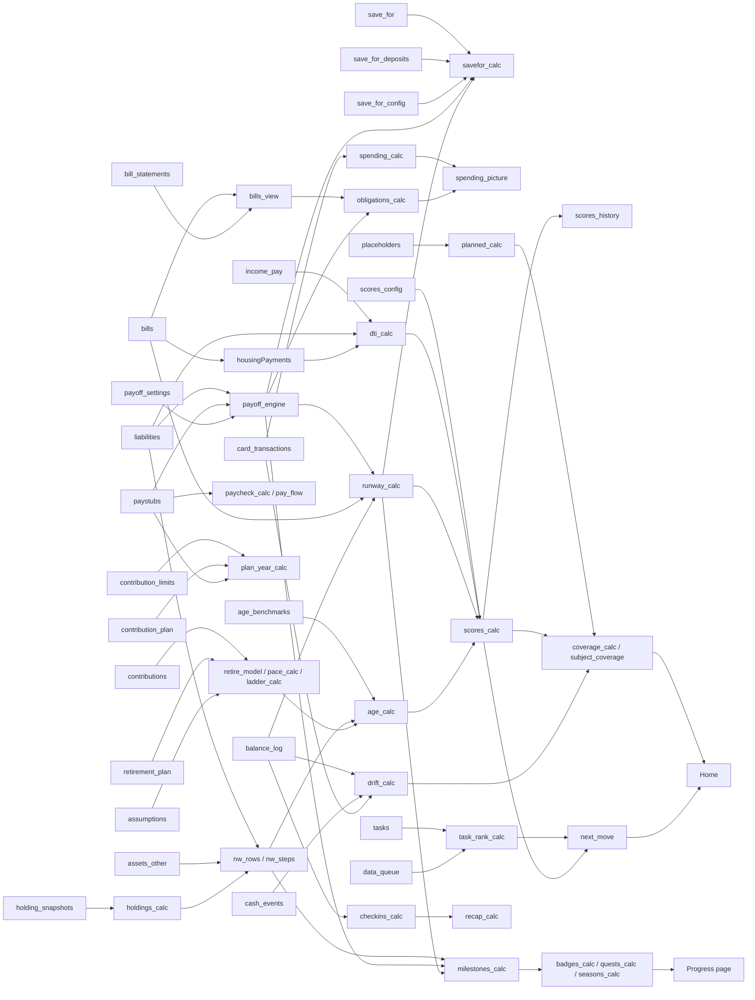

# Money Operations Center: architecture and build guide

Document version: v4.0, refreshed to page stage 6i (see CHANGELOG.md and VERSION). Section numbers are stable: other documents in this bundle cite them, so they are never renumbered.

Two version series exist and must not be confused. Document versions number this file. Feature versions in CHANGELOG.md number the features. A feature version never means a document version.

Where this file and the code disagree, the code wins and the check in tools/check_docs.js (or the open item in OPEN_ITEMS.md) says so. The tables in TILES.md, DATA_MODEL.md and CALCS.md are generated from the code; this file explains the rules behind them.

## 0. How to use this document

Audience: your own Claude agent, building the whole dashboard from these documents alone. There is no personal data in this bundle, so every number, name, rate, date and account on screen comes from you. Where a card or calculation lacks an input, the agent follows the MISSING-DATA PROTOCOL (section 3): it shows a plain "Needs: X" line, creates a task, and asks you the question in plain words before building any screen that depends on the answer.

Read order for the agent: README.md, CLAUDE.md, this file, then STYLE-GUIDE.md. CHANGELOG.md is history and is read last. PROMPTS.md holds the prompts for a first build and for an update of a dashboard that already exists.

Status key used on every page and card below:
- BUILT: the reference build had it working and tested. Build it.
- PLANNED: designed in full here, not built in the reference build. Build it in the stage named in section 17 and mark it PLANNED on screen with the Planned chip until it ships.
- OPTIONAL: build only if your situation needs it (the agent asks).

Placeholders used in this file: Item A, Card A, Account X, Plan Y, rate X percent, salary S, $0,000. They are never real. Money in examples is formatted $0,000.00.


## 0.1 Build status at page stage 6i

The reference build at stage 6i has 39 datasets, 58 calcs, 27 correlation checks, 28 profile questions and 64 mapped tiles on 10 pages (82 cards, 25 charts, 13 tables). The lists are generated from the code: DATA_MODEL.md, CALCS.md, TILES.md, CORRELATIONS.md, QUESTIONS.md.

| Area | Status at 6i |
|---|---|
| Data skeleton, missing-data protocol, Needs lines, tasks, data_queue, profile questions (sections 3 to 5, 15) | BUILT |
| Debt page, payoff engine, bills, pay, cash, runway, drift (sections 7, 8, 10) | BUILT |
| Retirement, the 401(k) percent card with the Limit reached chip, plan year tile, two Investments sections (current plan and the plan the money moves to) | BUILT |
| Progress layer: scores, age statistics, coverage, milestones, seasons, check-ins, quests, badges (section 12) | BUILT |
| Tile link rule and tile audit (section 13) | BUILT |
| About this fold on every card, one key number or chart per card, warnings stay visible (STYLE-GUIDE.md) | BUILT |
| Backup JSON and rebuild kit, schema mo-backup-2, verify_backup tool (section 18, BACKUP_FORMAT.md) | BUILT |
| Save for (section 11.1 to 11.5), spending calcs (7.7), savefor_calc (7.18) | PLANNED |
| metric_snapshots (monthly history of the headline numbers; CORRELATIONS.md) | PLANNED |
| Google Drive backup procedure (BACKUP_GOOGLE_DRIVE.md) | BUILT as a procedure Claude follows; the page itself only downloads |

Removed since the first design, with the approval that applied then: the rollover calcs and old rollover tile links, the duplicate charts on Investments and Retirement (one chart per fact), and task rows on the Progress page (a count chip links to Tasks).

## 1. Purpose and binding rules

Purpose: one private dashboard, a single Claude artifact, that shows where you stand with money, what to do next, and what is still missing. It is a planning tool built from numbers you enter. It is not financial, tax or legal advice.

Binding rules (the agent follows these in every build and every session):

1. Structure only. This package describes datasets, fields, calculations, screens and behaviors. It carries no one's figures, rates, balances, lender names, employer, state, ages or family names. Your numbers come from you.
2. Never invent a number. A missing number shows "Needs: X" and becomes a task. Use the amount you give until a statement proves otherwise, and label it "your amount" or "estimate".
3. Store each number once, as its latest confirmed value, with a source and an as-of date. A correction replaces the old value in place. Only history datasets keep dated rows (section 5).
4. Never store account numbers, SSN, routing numbers, loan ids or street addresses. Store extracted fields only. Keep originals in your own folder.
5. Housing is generic: a mortgage or rent, blank until you enter it. Debt to income (DTI) leaves rent out of the headline unless you have no mortgage, in which case rent takes the mortgage's place. A second line shows DTI with rent. Total monthly obligations (debt payments plus bills) is shown monthly and annual (sections 7.2 and 10.3).
6. Plain words. No em dashes and no en dashes anywhere, in text, code comments or data. No exclamation marks in dashboard copy.
7. Every build includes a dead code removal and optimization pass (section 19). It never removes gamified workflow, charts or graphs beyond what you approved. Moving them is fine. Count marks before and after.
8. Tell me about a better way. If something you ask for has a better alternative, the agent says so, and it double checks your own suggestions before building them.
9. Nothing is sent, published or shared on your behalf without your say. The change log marks every entry PENDING until you confirm it.
10. Backup is due the 1st of each month (section 18).
11. Gamification guardrails: no combined score, no streaks, no points for saving while high rate debt is unpaid, no comparison with other people beyond the sourced age statistics, calm copy, nothing earned by typing a number (section 12).

## 2. Artifact store model and LIVE RUNTIME FACTS

### 2.1 Layers

The dashboard is one Claude artifact of the Dashboard type (if your account offers it; otherwise one self-contained HTML page with the same structure). The page holds no data and no typed-in derived numbers. Everything is read from datasets and computed in calc functions, so a changed dataset updates every tile.

| Layer | What it is | Rule |
|---|---|---|
| Page parts | The page code, split into parts published under `files` (shell, one template and one draw part per page, calc part, shared helpers) | Each part under 200 KB. Parts run in separate scopes (2.3) |
| Datasets | One JSON file per topic, uploaded as an asset, each a non-empty array of plain row objects | Stable ids. Every money row carries `source` and `as_of_date` |
| Dataset docs | One document per dataset in a collection named `datasets`: title (30 characters at most), description, source pointer to the uploaded JSON asset, updated stamp | Writes are pinned to the version last read |
| Calcs | `dash.calc(id, {title, description, inputs:[dataset or calc ids], fn})` | Pure functions of their inputs. Return a "Needs: ..." message, never a guess |
| Page hooks | `dash.data(id)`, `dash.onData(cb)`, `dash.setLink(id)` | Redraw in `onData`. Draw only the page on screen; draw a hidden page when it opens |
| Capabilities | `claude.use("db")`, `claude.use("user")`, `claude.use("downloads")` | Each can be absent. Every use has a fallback (section 14) |

### 2.2 LIVE RUNTIME FACTS (observed contract 0.2.67 on the reference build; verify on your account with the Stage 0 probe, section 17)

These are facts about how the store and runtime behave. Each one broke a build in the reference project. The agent treats them as requirements.

1. **Nested objects and arrays arrive as JSON text.** A cell whose file value is an object or an array reaches the page as a string of JSON. A cell shaped `{value: scalar}` is unwrapped to the scalar. Read a nested cell only through a helper (`cellObj(v)`: if `typeof v === "string"`, JSON.parse it in try/catch; if already an object return it; else null). Keep nested cells to an allow-list of known columns (section 5.4). Everywhere else store flat scalars.
2. **Only a non-empty array of plain row objects loads.** The file must be an array of row objects, or an object whose `rows`, `data` or `results` key holds such an array. An empty array, a bare object, or an array of arrays fails to load, and every calc that lists the dataset as an input fails with it.
3. **An empty dataset needs a sentinel row or empty-state handling.** For a dataset with nothing real yet, ship one sentinel row (`item_id: "none"`, `status: "none"`, `placeholder: true`, every value field null). Readers strip it (section 4). Never rely on an empty file.
4. **A failed calc cascades.** A calc that throws becomes an error. Every calc that lists it as an input gets "<id> didn't run." and never runs. One bad read site can take down a dozen calcs. Each calc therefore guards its own reads (`cellObj`, null checks) and returns a Needs row instead of throwing.
5. **null versus undefined.** A key missing from a row arrives as null, and every row carries the union of all columns. Treat null as "not entered". Code that tests `=== undefined` never matches. A calc result is a structured clone (functions, undefined and class instances are lost; undefined becomes missing).
6. **CSV numbers are text.** If a dataset is uploaded as CSV, numeric columns arrive as strings. Use JSON.
7. **Calc inputs arrive in order as fresh shallow copies** of the dataset rows. A calc must never rely on mutating its inputs; return new objects instead.
8. **The first draw happens during loading.** `onData` can fire before every dataset has arrived. Draw functions must tolerate missing inputs and run again when the rest arrive.
9. **Page parts run as `Function("dash", ...)` in separate scopes.** A function in one part is not visible in another unless it is attached to a shared object (`dash.U = {...}` or a namespace). Declare shared helpers once in the shared part.
10. **No `window.__TODAY` on live.** Never read a test date global. Use one `TODAY()` helper that returns the current date, and let the test harness replace it.
11. **256 KB limit on each store document** (the JSON text of one dataset doc or one files doc). Split a large dataset (for example history rows) into two datasets before it nears the limit, and keep each page part under 200 KB.
12. **Document titles are 30 characters at most.** Dataset doc titles above 30 characters are rejected.
13. **Asset upload is one JSON per publish call.** Publish datasets first (one call each), then write the dataset docs in a batch pinned to the versions you read, then publish the page parts, then the shell last.
14. **Writes are pinned to a version.** Always read, change, write with the version you read. On a mismatch, re-read and redo.
15. **The page cannot write datasets.** The only write paths are the viewer's own private subtree in the shared database (section 14) and a "tell Claude" message box. Claude folds both into the datasets.
16. **No `position: fixed` and no `100vh`** are reliable inside the artifact frame. Build the bottom bar as a measured app shell (STYLE-GUIDE.md section 8).
17. **Browser storage is a convenience only.** localStorage can be blocked or empty. Wrap every read and write in try/catch and render correctly without it. Never keep data there.

### 2.3 The requirement to test on a harness that emulates the runtime

The most expensive failure in the reference project was a build that passed every test on a lenient harness and then failed on the live runtime, because nested config reached the page as JSON text and 12 calcs cascaded. Therefore:

- Build and keep a test harness that loads your datasets through a parser that behaves like the runtime (pseudocode below), runs the calc layer through an engine that behaves like `dash.calc` (ordered inputs, fresh shallow copies, structured-clone results, a throwing calc becomes an error and its dependents never run), and uses the same part-scope rule (each part wrapped as `Function("dash", ...)`).
- The harness must fail the build when any calc errors, when any dataset file would be rejected by the store, when any document exceeds 256 KB, when a title exceeds 30 characters, and when any part references a test-only global.
- A build that has not passed this harness is not published.

Runtime-faithful parser, in generic terms:

```
cell(v):  if v === null or typeof v is not object: return scalar(v)
          if v is not an array and "value" in v and typeof v.value is not object: return scalar(v.value)
          return JSON.stringify(v)                 // nested object or array becomes text
rows(file): j = JSON.parse(text)
            if j is an object: take the first array found in j.rows, j.data, j.results
            fail if there is no array, or it is empty, or any element is not a plain object
            columns = union of keys over all rows
            each row: for each column, own key present ? cell(value) : null
```

Calc engine rules to copy: inputs delivered in the order listed; each input a fresh shallow copy; result structured-cloned; an exception stores an error for that calc; a calc with an errored input does not run and reports "<id> didn't run."; the first draw is allowed before all data is present.

### 2.4 Write flow for any new fact

(1) Read the dataset doc and note its version. (2) Edit the JSON locally. (3) Upload the JSON asset (one per publish). (4) Update the dataset doc pinned to the version read. (5) On a mismatch re-read and redo. (6) Re-run the correlation checks (section 16) on the harness. (7) Republish page parts only if code changed. (8) Have a second agent recompute the changed number and everything that depends on it, then tell you in one or two sentences what changed.

## 3. MISSING-DATA PROTOCOL

This protocol is what lets the dashboard be built with no data at all and then fill itself in as you answer questions. It applies to every card, tile, chart, calculation and score.

### 3.1 The rule

Every card or calc that lacks an input does all four of these, every time:

1. **Shows one plain line: "Needs: X".** X names the missing thing in words ("Needs: the minimum payment from your latest statement for Card A"). The value slot never shows 0, a dash, "n/a" or an empty bar. A chart that cannot be drawn shows the Needs line in its place, and a score or total that would be wrong without the input shows the Needs line instead of a number.
2. **Creates a task.** The task title starts with a verb: "Add X" when you have to enter or tell something, "Send the downloaded statement for X" when a value came from a screenshot or from your own estimate and a statement should confirm it.
3. **Links that task to a data_queue item.** The data_queue item is the request ("I need X because Y"); the task is the to-do. Each holds the other's id (`task_id`, `queue_id`), so you can start from either list.
4. **Auto-completes on entry.** When the missing field is filled with an accepted source, the data_queue item becomes Provided and the task becomes Done (unverified until the check passes, section 12.4). Nobody ticks it by hand. The agent flips both in the same write batch that stores the value, and a page calc (`needs_sync_calc`, check C24) flags any pair that is out of step.

### 3.2 The agent asks first

Before building any screen that depends on a missing input, the agent asks you the question in plain words, one topic at a time, with an example of where to find the answer. The questions for every page are in the interview (section 15) and in the `question` field of each registry row (3.3). Rules:

- Ask, then build. If you answer, store the value and build the screen with real numbers.
- If you do not know or want to skip, the agent still builds the screen in its Needs state, records "skipped for now" in the registry row, and the Needs line says so. A skipped question is asked again at the next monthly review, never nagged more often.
- If you give an amount from memory, a screenshot or an old chat, the agent uses it right away, labels it "your amount" or "confirm on statement", and creates the "Send the downloaded statement for X" task. The amount is used until a statement proves otherwise. If the statement differs, the statement wins and the page shows the change once.
- A screenshot is accepted. Its values are used right away. A downloaded statement (PDF or CSV) is preferred, and only extracted values are kept, never account numbers.

### 3.3 The registry: one list, dataset `placeholders` (doc title "Planned and needed")

One row per waiting item. This is the single list behind every Needs line, every Planned chip and the More page list "Planned and data to add".

| Field | Type | Meaning |
|---|---|---|
| id | string | P1, P2, ... never reused |
| feature | string | Plain name of the item |
| status | Planned, Needs, Done | Planned = not built (or waits on time or on a publisher); Needs = waits on your data; Done = resolved, kept for history |
| kind | feature, data | |
| area | string | Debt, Bills, Cash, Save for, Retirement, Income, Taxes, Assets, Protection, Benchmarks, Write path |
| why_waiting | needs_you, runtime_unknown, depends_on, time, external | |
| depends_on | semicolon list of ids | Items that must be done first |
| needs | string beginning "Needs: " | Shown on the page and as the tooltip text |
| question | string | The plain-words question the agent asks you |
| owner_action | string | The "What to do" line |
| dataset | string | Where the data will live |
| fields | semicolon list | The fields it fills, as `dataset:row_id.field` |
| placeholder_rows | semicolon list | Flagged rows shipped now, as `dataset:id` |
| readers | semicolon list | Calcs and page elements that read it |
| chip_targets | semicolon list | Element ids where the chip shows |
| blocks | semicolon list | What it unlocks |
| queue_ids, task_ids | semicolon lists | The linked data_queue rows and tasks |
| resolve_dataset, resolve_key, resolve_field | s | Three flat fields naming the cell that turns the item satisfied when it is filled with an accepted source. The sync calc uses them |
| effort_hours | number | Build estimate for a feature row |
| template | row object or null | The future row for a dataset created on arrival |
| last_reviewed, resolved_on | date | |
| resolution | string or null | One sentence when Done |

Example row, structure only:

```json
{"id":"P1","feature":"Item A minimum payment","status":"Needs","kind":"data","area":"Debt","why_waiting":"needs_you","depends_on":"",
 "needs":"Needs: the minimum payment from your latest statement for Item A.","question":"What is the minimum payment on your latest statement for Item A?",
 "owner_action":"Send the downloaded statement for Item A.","dataset":"liabilities","fields":["liabilities:L1.monthly_payment"],
 "placeholder_rows":[],"readers":["dti_calc","payoff_engine"],"chip_targets":["debt-dti","po-plan"],"blocks":["debt to income","payoff plan"],
 "queue_ids":"Q1","task_ids":"T1","resolve_dataset":"liabilities","resolve_key":"L1","resolve_field":"monthly_payment",
 "effort_hours":0,"template":null,"last_reviewed":"YYYY-MM-DD","resolved_on":null,"resolution":null}
```

### 3.4 Generic registry rows every build ships (feature rows)

These are the same for every user. Data rows (the ones that need your numbers) are created from the interview as you answer or skip.

| Id | Feature | Status at day one | Waits on |
|---|---|---|---|
| P1 | Use this plan (Save for) | Planned | P2 and P3 |
| P2 | Saving changes from the page (tasks and Save for) | Needs, probe | The Stage 0 probe of the db capability (section 14) |
| P3 | Save for section (replaces any old goals list) | Planned until built, then Done | The build (stage 7) |
| P9 | Everyday spending in "This month" | Planned | Bank and card exports with full months (section 10.3) |
| P10 | Interest avoided so far on the payoff trail | Planned | Statements that show interest charged each month |
| P11 | Score since last month line | Planned | A second month end score snapshot |
| P19 | Savings account rate for Save for | Needs | The rate from your savings account |

Add data rows for each Needs line in the table of section 3.6 as they arise.

### 3.5 Calc `planned_calc` and the sync calc

- `planned_calc`. Inputs: placeholders, data_queue, tasks, and the datasets that can hold placeholder rows (read raw). Output: one row with `count`, `needs`, `planned`, `done`, `open_requests`, `orphans` (open requests with no registry row; must be 0), `rows` (sorted: most items blocked first, then least effort, then id), `done_rows`, `chips` (element id to registry rows) and `ghost_rows` (display only).
- `needs_sync_calc`. For every registry row with a `resolve_*` cell, tests whether the field is now filled with an accepted source. Output: per row `satisfied`; lists of tasks open while satisfied, tasks done while not satisfied, and queue rows out of step. Check C24 fails on any of them.

### 3.6 Needs by card (what each card or calc waits on)

Every line below is shown on the page as "Needs: <text>", has a registry row, a task and a data_queue item. "Where to find it" is read back to you in the question.

| Card or calc | Needs (plain words) | Task title | Where to find it |
|---|---|---|---|
| Debt to income (dti_calc) | gross pay, and the minimum payment of every debt | Add the minimum payment for Item A | latest statement |
| Payoff plan (payoff_engine) | take-home pay, bills, each debt balance, rate, minimum, due date | Add the due date for Item A | statements |
| Net worth (nw_rows) | at least one account or asset value, and debts | Add the balance of Account X | app or statement |
| Cash runway (runway_calc) | cash balances, essential bills | Add your bills | your own list |
| Bills tiles (bills_view) | at least one bill with an amount | Add a bill | statements |
| Total monthly obligations (obligations_calc) | bills and debt payments | Add your bills and debts | |
| Housing (housingPayments) | rent or a mortgage payment | Add your rent or mortgage payment | lease, statement |
| Scores (scores_calc) | components with data carry at least 60 percent of the weight | Add X (the top missing component) | |
| Age statistics | current age, net worth, income | Add your age | you |
| Retirement model (retire_model) | current age, target age, goal range, balances, contributions | Add your target retirement age | you |
| 401(k) percent card (pct_calc, plan_year_calc) | gross pay, pay stubs, chosen percent, plan limits for the year | Add your chosen 401(k) percent | you |
| Employer match | whether the plan has a match, and the formula | Add your employer match rule | plan summary |
| Pay (paycheck_calc, pay_flow) | at least one pay stub | Add your latest pay stub | payroll site |
| Dollar drift (drift_calc) | two balance readings on the same account and the flows between them | Add the balance of Account X on a second date | app |
| Save for | amount needed, amount saved, date if fixed, funding account | Add the amount needed for Item A | you |
| Everyday spending | two full months of statements per spending account | Send the downloaded statement for Account X | bank, card |
| Mortgage cards (OPTIONAL) | home value, lien balances, loan to value inputs | Add your home value | you |
| Insurance (score component) | coverage list | Add your insurance coverage | policies |

### 3.7 Asking order

When many items are open, the agent asks in this order, a few at a time: (1) items that block a core number (income, debts with minimums, cash balances, bills, housing), (2) items that block a score or the payoff plan, (3) items that block a chart, (4) optional items. It never asks everything at once.

## 4. Placeholder rows and the skip rule

A placeholder row is the way an empty dataset still loads (2.2 fact 3) and the way a known-but-unvalued thing appears as a ghost row.

- Shape: `placeholder: true`, `status: "placeholder"` (or `"none"` for a store-only sentinel), `ph_ref` (its registry id), `ph_note`, and every value field null. It carries no figures.
- A placeholder field is a null field on a real row, plus `ph_refs` (list of registry ids) on that row.
- One central strip. In calcs: `PH_STRIP = r => Array.isArray(r) ? r.filter(x => !(x && x.placeholder === true)) : r;` and a wrapper `PH_CALC(id, o)` that registers the calc with its function wrapped so every array input is stripped first (unless `o.raw` is set). In draws: a `rows(id)` helper that strips. `rowsRaw(id)` exists only for the backup and for `planned_calc`. Totals and counts never include a placeholder.
- Sentinel row ids: `item_id: "none"`, `deposit_id: "none"`, `bill_id: "none"`, `goal_id: "none"`.
- Kinds of placeholders: a ghost bill (name known, amount null), a ghost asset (type known, value null), null liability fields (next due date, statement balance, credit limit, rate type, promo end date), a next-year contribution plan row with the chosen percent null, a next-year limits row until published, a Save for sentinel, and datasets created on arrival (`bank_transactions`, `statement_periods`, `equity_grants`, `prior_pay`, `tax_profile`, `insurance`) which wait as a `template` in the registry until the first real row exists.
- Chips are words, never digits: Planned (violet, dashed border, blueprint glyph) and Needs (warning color, solid border, "!" glyph). Shape carries meaning, not only color (STYLE-GUIDE.md section 9).
- A test builds the dashboard twice, once with placeholder rows and once without, and requires every calc output and every page text to be equal.

## 5. Dataset catalog and empty starter files

Types: s string, n number, d date (YYYY-MM-DD), Y/N flag, id string. Every money row has `source` (statement, stub, screenshot, bank export, lender letter, user said, estimate) and an as-of date. Field names here are the canonical schema; use them exactly.

### 5.1 The empty starter file rule

On day one every dataset file exists and loads (2.2 facts 2 and 3). Four kinds of starter:

| Code | Starter file holds | Used for |
|---|---|---|
| S | One sentinel row: the key field set to `"none"`, `placeholder: true`, `status: "none"`, every other field null | any dataset that fills from your data |
| C | One real settings row with the defaults given in 5.3 (no personal figures) | config datasets |
| R | One sentinel row, then rows the agent researches with a named source and year (a task "Look up X" is open until then) | public reference tables |
| D | None. Derived on the page, never stored | quests, check-ins, recap, badges, coverage |

Sentinel example (any S dataset; keys differ):

```json
[{"bill_id":"none","placeholder":true,"status":"none","name":null,"category":null,"monthly_amount":null,"essential":null,"notes":null}]
```

Files are JSON arrays of row objects (or `{"rows":[...]}`), UTF-8, no comments, no trailing commas. A config row with nested blocks is stored as `{"rows":[{...}]}` and read through `cellObj` (5.4).

### 5.2 Core datasets (needed by every user)

| Dataset | Key | Fields | Writer | Read by | Starter |
|---|---|---|---|---|---|
| retirement_plan | item | item s, value n or null, note s. Items: current_age, target_age, goal_low, goal_high, chosen_401k_pct (null until chosen; the chosen percent per plan year lives in contribution_plan) | interview | retire_model, pct_calc, age_calc | S |
| assumptions | item | item s, value n, note s. Items: return_cautious_real_pct, return_base_real_pct, return_optimistic_real_pct, inflation_pct, employer_401k_match_pct, combined_marginal_tax_pct, high_apr_threshold_pct, card_min_estimate_pct. Defaults proposed to you (you confirm): 3, 4.5, 6, 2.5, null, null, 10, 4 | agent proposes, you confirm | retire_model, pace_calc, pct_calc, dti_calc, scores_calc | C (each value null until confirmed, except the four public-style defaults, labeled "assumption, not a forecast") |
| income_pay | income_id | income_id id, source s, kind (Base, Variable, Other), annual_gross n, per_paycheck n or null, paychecks_per_year n or null, first_pay_date d or null, pay_schedule s, pay_schedule_note s, status s | interview, stubs | dti_calc, pay_flow, pct_calc, retire_model, plan_year_calc | S |
| paystubs | pay_date | pay_date d, period_start d, period_end d, gross, federal_tax, state_tax, fica, taxes, k401_you, hsa_you, hsa_employer, benefits, garnishment, other_deductions, take_home_core, net_pay, other_additions (all n), ytd_gross, ytd_k401_you, ytd_hsa_you, ytd_hsa_employer, ytd_net_pay | stub ingestion | paycheck_calc, pay_flow, drift_calc, contrib_calc, plan_year_calc | S |
| contributions | account_id | account_id id, account s (your own label), tax_type s, employee_annual n, employer_annual n, limit_annual n, paychecks_per_year n, source s, notes s | stubs, plan docs | contrib_calc, retire_model, ladder_calc | S |
| liabilities | liability_id | liability_id id, name s, type (Mortgage, HELOC, Credit card, Loan, Tax, Medical, Other), balance n, rate_pct n, rate_confirmed Y/N, rate_type (fixed, variable), monthly_payment n, principal_interest n, counts_in_dti Y/N, withheld_monthly n or null (amounts taken from pay before take-home), as_of_date d, source s, notes s, estimate_note s, maturity d or null, original_balance n or null, credit_limit n or null, secured Y/N, secured_by s, prepayment_penalty Y/N, late_fee n or null, last_late_date d or null, days_past_due n (0 if current), promo_end_date d or null, post_promo_rate_pct n or null, statement_balance n or null, next_due_date d or null, amount_due n or null, late_after d or null, balance_basis s, reported_balance n, reported_date d, expected_balance n or null, expected_date d or null, expected_is_reported Y/N, pmi_monthly n or null, pmi_paid_from_escrow Y/N | statements | nw_rows, dti_calc, payoff_engine, home_calc, drift_calc, scores_calc, runway_calc | S |
| assets_other | asset_id | asset_id id, name s, type (Real estate, Vehicle, Cash, HSA, Receivable, Other), value_point n, purchase_price n or null, sell_cost_low_pct n or null, sell_cost_high_pct n or null, as_of_date d, source s, notes s | interview, balance reports | nw_rows, home_calc, account_calc, pending_calc | S |
| bills | bill_id | bill_id id, name s, category s, monthly_amount n (always the monthly equivalent), essential Yes/No, notes s, kind (bill, spending), housing (rent, none), due_day n (1 to 31) or null, frequency (monthly, every_2_months, quarterly, twice_a_year, yearly, weekly), amount_per_charge n or null, autopay Y/N or null, statement_source s, status (confirmed, expected, estimated), currency s, paid_by_liability_id id or null, statement_names s (semicolon list), landlord_label s, lease_end_date d or null, deposit_amount n or null, renters_insurance_bill_id id or null | interview | bills_calc, bills_view, bills_cat, obligations_calc, pay_flow, payoff_engine, runway_calc | S, with the sentinel carrying `housing: "rent"`, `name: "Rent"` so the first ghost row reads "Rent, Needs: add your rent" |
| bill_statements | bill, statement_date | bill_id id (link), bill s, statement_date d, due_date d or null, amount n, source s, note s | statement ingestion | bills_view, card-billhist | S |
| balance_log | log_id | log_id id, date d, account s, kind s, reported_balance n, source s | you, statements | drift_calc, account_calc, nw_rows | S |
| cash_events | event_id | event_id id, date d, account s or "Not confirmed", kind s (Pay deposit, Transfer, Bill, Card payment, One time), amount n (in positive, out negative), counts_as_spend Y/N, recurring Y/N, note s | stubs, statements, you | drift_calc | S |
| card_transactions | txn_id | txn_id id, date d, merchant s, amount n, category s, foreign Y/N, card s (issuer and product only), statement_close d, notes s, kind (purchase, refund, payment, fee, interest, transfer), bill_id id or null, liability_id id or null, one_time Y/N, statement_id s | statement ingestion | drift_calc, spending_calc | S |
| networth_history | date | date d, assets n, debts n, retirement n, net_worth n, note s | monthly snapshot | nwTrend, home history card | S |
| holding_snapshots | snapshot_date, account, fund | snapshot_date d, account s, fund s, ticker s or null, asset_class s, quantity n, price n, cost_basis_per_share n, value n, gain_loss n | statements | holdings_calc, all_holdings, by_account, by_class | S |
| contribution_limits | year | year n, k401_deferral n, k401_catchup n, k401_catchup_60_63 n or null, k401_total_additions n, hsa_self n, hsa_family n, hsa_catchup n, ira n, ira_catchup n, status (published, estimate), source s, url s, as_of_checked d | agent looks it up (public figures with a named source) | plan_year_calc, pct_calc, contrib_calc, ladder_calc | R |
| contribution_plan | plan_year | plan_year n, chosen_401k_pct n or null, chosen_hsa_per_paycheck n or null, plan_year_start d, as_of d, source s, note s | your choice on the 401(k) card | plan_year_calc, pct_calc, retire_model | S |
| payoff_settings | setting_id | setting_id id, chosen_strategy (smart, highest_rate, smallest_balance), extra_per_month n or null, budget_basis s, as_of d, note s | your choice on the Debt page | payoff_engine | S |
| dti_benchmarks | standard | standard s, front_end_pct n or null, back_end_pct n, note s (source named) | agent looks it up | dti_calc, debt-dti | R |
| data_queue | queue_id | queue_id id, priority n, item s, why s, question s, area s, status (Needed, Statement requested, Provided, Observation, Dashboard to do), task_id id or null, source_kind (statement, screenshot, user said), needs_ref s (registry id) | agent | Home, Tasks (Data view), coverage_calc, R9 | S |
| tasks | id | id id, task s, area s, status (To do, Open, In progress, Done; To do and Open stay separate), note s, due_date d or null, priority (High, Medium, Low or null), effort (Low, Medium, High), created d, done_date d or null, queue_id id or null, bill_id id or null, verified_on d or null, checks_run s (semicolon list of check ids), metric s, metric_before n or null, metric_after n or null | agent, task actions (section 14) | Home task list, Tasks page, next_move, quests, coverage, backup reminder | S |
| placeholders | id | see 3.3 | agent | planned_calc, needs_sync_calc, chips | E (the generic rows of 3.4) |

### 5.3 Save for datasets (BUILT in design, PLANNED to build)

| Dataset | Key | Fields | Starter |
|---|---|---|---|
| save_for | item_id | item_id id (S1, S2 ...), name s (1 to 40 characters, rejected if it holds a run of 6 or more digits), kind (vacation, car_repair, move, taxes, home_repair, gift, other), amount_needed n, amount_saved_reported n (0 allowed), saved_reported_on d, saved_source (statement, screenshot, user said), target_date d or null, date_type (fixed, flexible), priority n, essential Yes/No, funding_account s ("Not decided" allowed), plan_monthly n or null, rate_pct n or null, status (active, paused, funded, done, cancelled, none), created_on d, funded_on d or null, done_on d or null, spent_amount n or null, linked_liability_id id or null, migrated_from s or null, notes s, source s, updated_on d | S (`item_id: "none"`, `status: "none"`) |
| save_for_deposits | deposit_id | deposit_id id, item_id id, date d, amount n (positive set aside, negative taken back or spent), kind (deposit, withdrawal, spend, lump, correction), account s, cash_event_id id or null, source s, note s | S (`deposit_id: "none"`) |
| save_for_config | config_id | config_id id (SFC1), pace_min_share n (0.10), pace_comf_share n (0.25), savings_rate_pct n or null (null: 0 percent used and a Needs line), chosen_strategy s or null (recommended, schedule, priority, smallest, debt_first), chosen_pace s or null (minimum, comfortable, fast), chosen_on d or null, chosen_source s or null, last_change s or null, last_change_on d or null, exclude_earmarked_from_cushion Y/N (Y) | C (one real row; chosen_strategy null means no plan is in use) |

### 5.4 Config, reference and derived datasets

| Dataset | Fields | Starter |
|---|---|---|
| scores_config | version, as_of, disclaimer, how_it_works, reweight {method, show_range, min_weight_coverage_pct (60), below_min}, trend {min_snapshots (6), min_days_span (60)}, inputs {liquid asset ids, high-rate cutoff, card minimum estimate percent}, financial and risk blocks each {title, scale, labels [{min, label}], components [{id, name, weight, metric, unit, best, worst, formula, source, requires, needs}]}. Weights sum to 100 per score (section 7.12) | C, one row, nested blocks stored as JSON text (read with `cellObj`) |
| age_benchmarks | id, metric, age_group, statistic (median, mean, percentile, guideline, share, total), value, unit, data_year, source, url, population_note, as_of_checked, confidence (optional) | R. Public statistics only. Row id pattern: metric_statistic_agegroup |
| age_metrics_config | version, as_of, benchmarks_file, disclaimer, age_lookup {age source, bracket rule, row id pattern, interpolation}, label_vocabulary, peer_group_notes, metrics [id, title, formula, inputs, benchmark_rows, label_thresholds, meaning, display, caveats], data_needs_to_check | C, one row, nested blocks as JSON text |
| rewards_config | version, coverage_fresh_days (45), drift_tolerance_per_account (you set), checkin_window_days (7), checkin_weeks (12), accepted_sources (statement, stub, screenshot, bank export, lender letter), families {debt_pct steps 75/50/25/0, emergency_months 0.5/1/2/3/6, interest_avoided step, pace_pct 25/50/75/100, net_worth step rule, drift steps}, badges | C |
| spending_config | min_full_months (2), window_months (3), categories (Groceries, Dining, Fuel, Shopping, Travel, Subscriptions and software, Utilities and internet, Insurance, Pets, Health, Personal, Other), excluded_account_types (HSA), merchant_rules (match text, then bill_id or kind or category; empty at day one) | C |
| ltv_benchmarks (OPTIONAL, with a home) | id, measure, pct, label, basis, source, url, data_year, as_of_checked, confidence, note | R |
| scores_history | date, financial, risk, financial_label, risk_label, n_components_financial, n_components_risk, coverage_financial, coverage_risk, config_version, component_points (text map), note | S |
| drift_history | check_id, account, date, from, opening, inflows, outflows, expected, reported, drift, first_drift, first_computed_on, computed_on, basis | S |
| milestones | milestone_id id, family, subject, step, value_at, evidence_dataset, evidence_id, direction (up, down), status (earned, retracted), earned_on d, retracted_on d or null, note | S |
| quests, checkins, weekly_recap, badges, coverage, subject_coverage | computed live from tasks, data_queue, balance_log, milestones, bills_view | D (none stored) |

Nested columns allow-list: the only columns that may hold nested objects are the config blocks named above, `scores_history.component_points`, and nothing else. Every other column is a flat scalar. Lists are stored as semicolon separated text (`checks_run`, `statement_names`, and every list field of the placeholders registry).

### 5.5 OPTIONAL datasets (build only if your situation needs them; the agent asks)

Status at page stage 6i: none of the datasets in this table is in the shipped page, the templates or demo_data (the page does not read them, and they have no DATA_MODEL.md entry). They are designs kept for an owner who asks for the feature: the old plan, target mix, picks, rollover and transfer tracker, the researched-ticker archive and the bank transaction table were removed or never built (see the Removed note in section 0.1). Do not build one unless the user asks; if one is built, add its template, demo file, DATA_MODEL entry, tile rows and tests in the same change.

| Dataset | Purpose | Fields |
|---|---|---|
| mortgage_statements | A mortgage or HELOC with monthly statements | statement_date, principal_balance, rate, next_due, amount_due, principal_due, interest_due, escrow_due, late_fee, late_after, escrow_balance, prepay_penalty, maturity, last_month_paid, ytd_principal, ytd_interest, ytd_escrow, ytd_fees, ytd_total, kind (statement, annual_form_1098, escrow_analysis), source |
| old_plan_sources, old_plan_holdings, plan_stats, plan_summary | An old workplace plan you are tracking | sources: source, tax_type, balance, destination. holdings: fund, pct_of_plan, quantity, cost_basis_per_share, last_price, value, gain_loss, asset_class. stats: period_start, period_end, beginning_balance, ending_balance, personal_return_pct, dividends_interest, stock_pct, bond_pct. summary: item, amount |
| target_mix, model_picks | A second plan with a target mix against actual, and a picks list | target_mix: fund, short, ticker, asset_class, value, target_pct. model_picks: ticker, name, role, current_pct, proposed_pct, ai_linked, asset_class |
| transfers | Rollover or transfer tracker. Do not build unless you ask | id, kind, step, from_account, to_account, amount, tax_type, status, next_action, blocker |
| price_history | Fund price growth between two dates | fund, start_date, start_price, end_date, end_price, note |
| candidates | Archive of researched tickers, kept as data, never shown as a table | ticker, name, theme, type, er_pct, one_yr_pct, from_high_pct, verdict fields, size_pct, note |
| bank_transactions, statement_periods | Created on the first bank export | bank_transactions: txn_id, date, account_ref (asset_id), account_label, description, amount (out negative), category, kind (purchase, bill, debt_payment, card_payment, transfer_own, pay_deposit, income_other, refund, fee, cash), bill_id, liability_id, linked_txn_id, one_time, statement_id. statement_periods: statement_id, account_ref, account_label, period_start, period_end, source_kind (pdf, csv), rows, loaded_on. No account numbers |
| insurance | Unlocks score component F9 | item s, in_place Y/N, coverage s, premium n or null, as_of d, source s. No policy numbers |

Not in this build: mortgage_annual and the Form 1098 card (approved for removal), savings_goals (replaced by Save for), the old checklist.

## 6. Data relationship map



## 7. Calculations

Every calc is a pure function registered with `dash.calc(id, {title, description, inputs, fn})` through `PH_CALC` (section 4). Every calc guards its reads, returns a "Needs: X" row when an input is missing, and never throws (2.2 fact 4). Formulas are generic. Symbols: S salary (gross annual), M gross monthly income, p paychecks per year, r real return, i inflation, n years, C yearly contribution, B0 start balance, T take-home per month, TODAY() the current date.

Status for every calc below: BUILT in the reference build unless marked PLANNED.

### 7.1 Net worth (nw_rows, nw_steps, account_calc, pending_calc)

- Inputs: assets_other, liabilities, holding_snapshots (retirement and investment balances), balance_log, networth_history.
- Formula: NW = A minus D. A = cash + investments + retirement + HSA cash + home value + vehicle value + other counted assets (estimated values labeled). D = sum of liability balances (the expected balance when it is newer than the reported one, 7.17). Receivable rows and unreceived money are shown apart and are not in A. Home equity = home value minus liens, shown under assets only (never counted twice).
- Outputs: A, D, NW, rows for the tiles, waterfall steps (assets up, debts down), split of where each dollar sits by account, the change since the last snapshot.
- Needs: at least one asset or debt value. With nothing entered: "Needs: your accounts and debts".

### 7.2 Housing, debt to income and obligations (housingPayments, dti_calc, obligations_calc)

`housingPayments(liabilities, bills)` returns `{kind, amount, mortgage_amount, rent_amount}`:
- If any Mortgage liability has a payment: kind = "mortgage", amount = mortgage + HELOC payments. Rent is left out of the headline.
- Else if any bill has `housing = "rent"`: kind = "rent", amount = sum of rent bills.
- Else kind = "none" and the housing slot says "Needs: your rent or mortgage payment".

`dti_calc`:
- Gross monthly M = annual_gross of all income rows / 12 (Base plus Variable plus Other rows you tell the agent to count).
- Debt payments counted = sum of monthly_payment where counts_in_dti = Y (mortgage, HELOC, auto, student, personal loans, card minimums, court-ordered support). Do not count utilities, insurance outside a mortgage, subscriptions, or medical bills on a plan. Amounts withheld from pay are counted here and left out of the payoff surplus (7.4).
- Headline back-end DTI = (debt payments counted) / M x 100 when kind = "mortgage" or "none". When kind = "rent" (no mortgage), the headline adds rent: (debt payments counted + rent) / M x 100, and the label says "includes rent because you have no mortgage".
- Second line, always shown when a rent bill exists: "With rent: (debt payments counted + rent) / M x 100". With no mortgage it equals the headline and says "rent already counted".
- Housing ratio = housing amount / M x 100.
- Missing minimum on a card: show two figures, entered payments only, and with a labeled estimate of `card_min_estimate_pct` (default 4 percent) of the balance. Show the count of debts missing a payment, each a link to its task.
- Benchmarks (36 and 43 percent) come from dti_benchmarks with the source named on screen.
- Needs: gross pay and at least one debt payment, or "No debts entered" confirmed by you.

`obligations_calc` (Total monthly obligations):
- debt = the payoff engine's monthly minimums (mortgage counted once, withheld amounts excluded); bills = sum of counted bills (7.5, rent included); monthly total = debt + bills; annual total = monthly total x 12.
- take = take-home per month; left over = take minus monthly total (equals the payoff surplus); share of take-home = monthly total / take x 100.
- withheld = amounts taken from pay before take-home, shown as a separate line that is not in the total.
- reconciliation: the DTI debt payments + card estimate minus withheld = debt (identity, check C26).
- runway box: must-pay = essential bills + debt payments + withheld; months = cash / must-pay; with every bill counted, a second months figure.
- Needs: "Needs: your bills and debts" until both lists have a counted row.

### 7.3 Home value and loan to value (home_calc, house_split, ltv_calc) OPTIONAL, hides with no Real estate asset

- Combined LTV = (first mortgage + HELOC) / home value. First-lien LTV = first mortgage / home value. Net if sold range = value minus liens minus value x (sell_cost_low_pct to sell_cost_high_pct). Say where the value came from.
- Needs: home value with source and date, every lien balance. With no house the whole group hides and Assets shows one line: "No home owned, so house equity is not used".

### 7.4 Debt payoff (payoff_calc, payoff_base, payoff_engine, debt_steps_calc)

`payoff_calc` is the single-debt baseline: monthly interest = b x rate_pct / 1200; b = b + interest minus payment; stop at 0 or 720 months; if payment <= interest flag "payment does not cover interest". It feeds the payoff timeline.

`payoff_engine` (full rules in 8.3): surplus = take-home minus bills minus debt payments; extra E = max(0, surplus minus the cushion hold, 7.6); smart order; monthly compounding; Next payment recommendation; plan comparison (Smart, Highest rate, Smallest balance, Minimums only); per-debt trail. When Save for has a chosen plan, E is reduced by the plan's monthly amount (7.18).

`debt_steps_calc`: for each debt with an original balance, steps at under 75, 50 and 25 percent and at 0; "Needs: original balance" otherwise.

- Needs: take-home, bills, each debt balance, rate, minimum and due date. A missing due date gives "Needs: due date" in the Next payment card and a task.

### 7.5 Bills (bills_calc, bills_cat, billsCounted, bills_view)

- `billsCounted(bills)`: drops sentinel rows and any bill with `paid_by_liability_id` (so an escrowed tax or a mortgage typed in as a bill is never counted twice). bills_calc, bills_cat, pay_flow, payoff_engine and scores_calc all use it.
- bills_calc: total_monthly = sum of counted monthly_amount; annual = total x 12; share of gross = total / M; share of take-home = total / T.
- bills_cat: totals by category, descending, for the stacked bar and legend.
- bills_view (inputs: bills, bill_statements, payoff_engine, tasks, data_queue):
  - rows: every bill with resolved fields and a `needs` list; linked statements (count, latest, prior, change), task ids.
  - totals: total, essential, other, by_status {amount, count} (Confirmed = amount on a statement; Confirmed by you = you confirmed it is real, no statement yet; Estimated = estimate or average), pct_take_home, ess_pct_take_home.
  - due_30: for each bill with a due day, next occurrence = this month's day if today or later, else next month's (clamped to the month length); with no due day the next statement date (latest statement_date + 1 month); keep TODAY() to TODAY() + 30.
  - missing_statement (kind bill, no linked statement row, status not Confirmed), missing_due, housing_rent (names and amounts), changes (two most recent linked statements per bill).
- A bill with no `essential` flag shows "Needs: essential or not" and counts as essential for runway (the safe side).
- Needs: "Needs: add your bills" with no counted row.

### 7.6 Cash runway (runway_calc)

- Inputs: payoff_engine, scores_calc, liabilities, balance_log, bills.
- Months = liquid cash / must-pay per month. Liquid cash = balances of the accounts listed in scores_config.inputs as liquid, minus money set aside for Save for when `exclude_earmarked_from_cushion` is Y. Must-pay = essential bills + every debt payment + withheld amounts.
- Steps at 0.5, 1, 2, 3 and 6 months; gap to a step = step x must-pay minus cash.
- Cushion hold H = (must-pay x 1 month) minus cash, per month, never below 0 (the payoff engine keeps this back before sending extra to debt).
- This month: take-home, bills, debt payments, left over (the same figures as obligations_calc).
- Coming up: debts and bills due in the next 45 days from due dates; a debt with no due date lists as "Needs: due date".
- Needs: cash balances and essential bills.

### 7.7 Spending (spending_coverage, spending_calc, spending_picture) PLANNED (registry P9)

- Spending accounts = assets of type Cash plus liabilities of type Credit card, minus excluded types. Never a hard coded list.
- Coverage per account: the days covered by its statement periods. A full month is a calendar month every spending account covers end to end. Weeks covered = days in the longest stretch every account covers, divided by 7. Account share = accounts with a period ending in the last 45 days over all spending accounts.
- The estimate shows only when full months >= `min_full_months`. Estimate = counted outflows over the last up to `window_months` full months, divided by the number of months, labeled "estimate from N weeks of statements". Below the minimum: "Needs: 2 full months of statements" plus a Needs row per account with its "Send the downloaded statement for Account X" task.
- Not counted (so nothing is counted twice): card payments (the bank outflow and the card credit), transfers between your own accounts (kind transfer_own, or matched pairs of equal and opposite amounts within 3 days), debt payments, pay deposits and other income, card interest and fees (shown apart as debt cost), and any charge that pays a bill of kind bill (already in obligations). Refunds net against purchases in their category. One-time items are listed and kept out of the monthly estimate.
- spending_picture: left over after spending = take-home minus (debt payments + bills of kind bill) minus the everyday estimate. The spending-kind bills leave the picture once the estimate shows, because measured spending replaces them (the Bills total does not change). Until the estimate exists: obligations shown, spending "Needs", and left over "before everyday spending". Identity: left over after spending + spending + obligations = take-home.

### 7.8 Pay (paycheck_calc, pay_flow, pay_split, stubcheck_calc)

- Latest paycheck split: take-home, taxes, retirement, benefits, support or garnishment. Monthly take-home T = latest net_pay x paychecks_per_year / 12, labeled an estimate; with fewer than about 12 stubs say "N paychecks on file" and do not project from a window with a one-time payment or a deliberate change.
- Savings rate = (retirement + HSA + savings) / gross.
- stubcheck_calc: each stub with take-home, taxes, 401(k), health, and the deposit seen in cash_events on the pay date; gap = deposit minus net pay; a stub with no deposit says "Needs: the deposit".
- Needs: at least one pay stub or a per paycheck amount.

### 7.9 Dollar drift and accounts (drift_calc, drift_all, account_calc)

- For two reported balances on the same account at dates d0 < d1: expected = bal(d0) + inflows in (d0, d1] minus outflows in (d0, d1]; drift = bal(d1) minus expected. Cards: expected = last balance + known charges minus known payments; a reported value above expected is "unexplained spending", shown as one positive number per account and in total, never an invented cause.
- Events with account "Not confirmed" feed only a total-cash pair. ATM withdrawals and cash transfers carry an "ATM" label, count as a known outflow and are listed as "cash spending not tracked".
- Each check point is saved in drift_history (first_drift kept). When data arrives, earlier points are recomputed and the page says "drift on date was X, after statements it is Y". A trend shows only with 3 or more check points.
- Needs: a second reading per account: "Needs: the balance of Account X on a second date".

### 7.10 Holdings (holdings_calc, all_holdings, by_account, by_class, perf_series) OPTIONAL with investments

- Position value = quantity x price; gain or loss = value minus cost basis x quantity; allocation by asset_class; by account; performance series from snapshots. Holdings must sum to the account balance (check C2).
- Needs: a holdings export. A fund with no asset_class shows "Needs: asset class".

### 7.11 Retirement (retire_model, pace_calc, age60_calc, ladder_calc, pct_calc, contrib_calc, plan_year_calc, pace_steps_calc)

- Projection: FV = B0 (1+r)^n + C ((1+r)^n minus 1) / r, contributions at year end, today's dollars. Three real paths from assumptions (cautious, base, optimistic); nominal = (1+r)(1+i) minus 1. Two cases: today's stub contributions (per paycheck x p), and "at the limit (maxed)" using limit_annual per account. Need to reach goal_low: C* = (goal minus B0 (1+r)^n) x r / ((1+r)^n minus 1). Extra per month to max = (sum limits minus sum current) / 12.
- `age60_calc` is the same model evaluated at the target age you give (the page name says "at <target age>", never a fixed age).
- 401(k) percent of salary (pct_calc): for percent q in 0 to 15 step 0.5: per year = q x S; per paycheck = q x S / p; cap q_max = limit / S; warn above q_max. Take-home drop = pre-tax dollars change x (1 minus t), t the combined marginal rate you give (labeled estimate, rate named). Balance at target age uses the projection with only the 401(k) contribution varying. chosen_401k_pct null shows "Try a rate".
- Plan-year tile (plan_year_calc): section 8.4.
- Needs: current age, target age, goal range, balances, contributions.

### 7.12 Scores (scores_calc) and score history

Rules in 8.1. Needs: components with data carry at least 60 percent of the weight, else "Not enough data" and the Needs list.

### 7.13 Age statistics (age_calc, bench_age_calc)

Rules in 8.2. Needs: age and a sourced benchmark row, else "Needs data" on that form.

### 7.14 Progress (coverage_calc, subject_coverage, milestones_calc, seasons_calc, checkins_calc, recap_calc, quests_calc, badges_calc, moves_calc, next_move, score_since_calc)

Rules in section 12. Needs: each shows its own Needs line; none shows a number made of nothing.

### 7.15 Tasks (task_rank_calc, statement_sync_calc, needs_sync_calc, planned_calc)

- task_rank_calc: open tasks (status not Done) ranked by due date (no date after every dated task), then priority (High, Medium, not set, Low), then the score weight the task unlocks (largest first), then file order. Also the data requests still needed (status Needed or Statement requested) by order number. One definition everywhere: still needed = Needed or Statement requested.
- statement_sync_calc and needs_sync_calc: 3.5.

### 7.16 Checks (checks_calc)

Section 16. Status per check is pass, needs (data missing) or fail.

### 7.17 Expected versus reported values

- A reported value is what a bank, servicer or statement said on a date. An expected value is a projection: the last reported value plus every confirmed inflow minus every confirmed outflow after that date (for a loan, the balance the schedule gives after a confirmed payment).
- Both are stored (reported_balance, reported_date, expected_balance, expected_date, expected_is_reported). Current totals use the expected value when it is newer than the reported one, labeled "expected from confirmed events on <date>, not a bank or servicer reading", with the reported value and date beside it. They are never merged into one number.
- Events not yet in any reported balance count as expected outflows after the last reading. An event with unknown effect is listed as an open question and not applied. One real movement is never applied twice. A pending event never changes a balance.

### 7.18 Save for (savefor_calc) PLANNED

Section 11.3.

## 8. Calculation rules in full

These are the longer rules behind section 7. Defaults are design choices you can change in the config datasets.

### 8.1 Scores (scores_calc)

Design source of truth: scores_config (5.4). Structure only; the best and worst values below are design defaults the user may change in the config, and any component the user's situation does not have is dropped, not forced.

How a score is built:
1. Each component has one measured value, a best level and a worst level. fraction = clamp((value minus worst) / (best minus worst), 0, 1).
2. Financial points = fraction x weight. Risk points = (1 minus fraction) x weight.
3. Score = points / weight of components that have data x 100. A component without data shows "Needs: ..." and is left out; the card says "based on N of M components".
4. Range: the score if every Needs component earned the worst result, and if it earned full marks. Shown as "Could land X to Y once the Needs are filled".
5. If the components with data carry under 60 percent of the total weight, show "Not enough data" and the Needs list, no number.
6. Labels. Financial: 80 and up Strong, 60 to 79 Solid, 40 to 59 Building, under 40 Needs attention. Risk: 75 and up High, 50 to 74 Elevated, 25 to 49 Moderate, under 25 Low. Color never carries the label alone.
7. Any input that is a guess (a card minimum at 4 percent of balance, an estimated payment, a planned amount) is named in the component's input line.
8. No trend arrow, sparkline or green or red delta until scores_history has 6 snapshots across 60 days.
9. Footer on both cards: "A planning tool built from numbers you entered. Not financial, tax or legal advice."
10. A component that does not apply to you (no house, no foreign cost, no variable-rate debt) is "Not used": it leaves the weight, is not a Needs, and the card says so. Only a component that applies but lacks data is a Needs.

Default components (weights sum to 100 per score):

| Financial | Weight | Best | Worst | Metric in plain words |
|---|---|---|---|---|
| F1 Debt to income | 12 | 20 | 50 | back-end DTI percent (7.2), card minimums estimated at 4 percent of balance when missing |
| F2 High interest debt burden | 14 | 0 | 20 | balances above a high-rate cutoff (default 10 percent APR) as percent of annual gross |
| F3 Emergency fund | 14 | 6 | 0 | liquid cash / monthly must-pay outflow, in months |
| F4 Savings rate from payroll | 10 | 15 | 0 | (employee + employer contributions) / gross, percent |
| F5 Retirement pace vs goal | 18 | 100 | 0 | balance at target age / goal_low, percent (7.11) |
| F6 Monthly cash flow surplus | 10 | 20 | 0 | surplus (8.3) as percent of take-home; only scored once spending is real, not estimated |
| F7 Net worth vs age benchmark | 8 | set by 8.2 | set by 8.2 | percent of typical, from age_benchmarks; Needs until a sourced row exists |
| F8 Credit utilization | 6 | 10 | 60 | card balances / credit limits, percent; Needs credit_limit |
| F9 Insurance and protection | 8 | 100 | 0 | share of the checklist in place; Needs the insurance dataset |

| Risk | Weight | Best | Worst | Metric in plain words |
|---|---|---|---|---|
| R1 Concentration in one theme | 14 | 10 | 40 | percent of investments in one theme the user names (optional) |
| R2 Single income earner | 16 | 50 | 100 | share of household income from one earner |
| R3 Liquidity runway | 16 | 6 | 0.5 | months of cash against must-pay outflow |
| R4 Debt rate sensitivity | 10 | 0 | 3 | variable-rate balances as a share of income; Needs rate_type |
| R5 Combined loan to value | 10 | 50 | 90 | combined LTV percent (7.3) |
| R6 Total debt to total assets | 6 | 30 | 80 | percent |
| R7 Tax exposure | 8 | 0 | 100 | open tax balances and notices (optional) |
| R8 One-time planned cost | 10 | 0 | 30 | a planned large cost as percent of liquid cash (optional) |
| R9 Data completeness | 10 | 0 | 100 | share of Needs still open (reads the same gaps as the Scores ring) |

Home card (390 px): big number, label chip, "based on N of M components", range line, component bars with a text value beside each, "What would raise it" (top 3 by room, each with the number to change), Needs list (component, what to send, points it unlocks), "Show the math" accordion (formula, inputs, thresholds, source, dataset). Row weights and labels come from scores_config; values come from the same calc layer, so a corrected balance moves the score with no code change. History in scores_history (5.4).

### 8.2 Age statistics (age_calc)

Purpose: show where the user stands against people their age without a verdict from one number. A planning and motivation tool, not advice.

Lookup: the age comes from retirement_plan item current_age. Bracket rule (the survey's age of the reference person): under 35, 35 to 44, 45 to 54, 55 to 64, 65 to 74, 75 and over. Row ids follow the pattern in age_metrics_config (age_lookup). A five-year band row, where present, is a cross-check only, never the headline.

Three percent forms (the only forms shown in the UI):

| Form | Formula | Reads as |
|---|---|---|
| Percent of guideline | value / guideline x 100. Guideline = a published guideline row (age_benchmarks statistic guideline), interpolated linearly between its published ages | "78 percent of the published guideline for your age" |
| Percent of typical | value / benchmark median x 100 (peer group named: families or households, survey, data year) | "120 percent of the typical family your age" |
| Percentile rank | interpolate the value between the published percentile rows (p25, p50, p75, p90, p95) for the bracket; below p25 show "below the 25th", above p95 show "above the 95th" | "between the 75th and 90th percentile" (approximate, label the rows' source and confidence) |

Rules:
1. A form shows "Needs data" when its source row is missing (for example no published percentiles for that metric). Never blank, never zero, never a borrowed number.
2. Never display an "x" multiple in the UI ("2.4x"). Internally a ratio may be computed (the config uses the word multiple in some formulas); convert to percent before display. Salary-multiple guidelines are shown as "percent of guideline".
3. Every figure on screen carries source, data year and dollar year (tap target "Source" opens the row: source, url, population_note, confidence).
4. Lead with the median and the percentile; show the mean only as context (it is 4 to 5 times the median for wealth).
5. Compare fairly: families versus households are different units; a married filer also sees the married-couple row where one exists; a single earner is compared on income-adjusted forms; holders-only medians (retirement, card balance) say "among those who have one".
6. Where sources disagree show the range with names, do not pick one silently.
7. Labels (ahead, on_track, behind, needs_data) come from age_metrics_config label_thresholds, which are design choices, not sourced. Expressed in percent: ahead from 125 percent of typical, on track from 75 to under 125, behind under 75, for net worth; the other metrics use their own thresholds from the config. Words accompany any color.
8. Never show a verdict from one number: show the guideline, the typical peer and the range.

Metrics in age_metrics_config (ids): nw_vs_median_age, nw_multiple_of_income, the retirement salary-guideline metric (shown as percent of the published guideline; its id in the shipped config names the publisher, so rename it neutrally in your build), years_to_guideline_pace (years ahead or behind, no multiple), projected_multiple_at_60 (use the user's own target age, shown as percent of guideline), savings_rate_vs_guideline, emergency_fund_months, credit_card_debt_vs_age, dti_vs_benchmark, income_vs_age_peers.

Where it appears: a summary on Home ("Where you stand at your age"), the age ladder on Retire (rungs at the guideline's ages, current rung marked, next rung with "needs about N more or N more years at the current pace"), the full table on More (every benchmark with source and year).

### 8.3 Debt payoff engine (payoff_engine)

Inputs: liabilities (balance B, rate_pct, monthly_payment as the statement minimum m, and the v2.1 fields), income_pay and paystubs (take-home), bills, payoff_settings. Output: a ranked order, a next-payment sentence, a schedule per strategy, a comparison, and a tracking trail per debt. Nothing here gives tax or legal advice; every special-case note says "confirm on the statement or notice".

Formulas. Let r = rate_pct / 1200 (monthly rate), B the balance, p the monthly payment, n months.
- Level payment for a fixed term: A = B r / (1 - (1 + r)^(-n)); if r = 0, A = B / n.
- Months to payoff at a constant payment p: n = -ln(1 - B r / p) / ln(1 + r) when p > B r; if r = 0, n = B / p; if p <= B r the balance never falls: flag "payment does not cover interest".
- Payoff date = as_of date + ceil(n) months (shown as month and year).
- The schedule below is the source of truth; the closed forms are used for checks (C17).

Surplus (the starting point of the slider):
- T = monthly take-home. Use the latest stub net_pay x paychecks_per_year / 12, labeled an estimate; with fewer than about 12 stubs say "N paychecks on file" (7.8).
- Bills = sum(bills.monthly_amount), leaving out any bill that is a debt payment already counted in Mins (never count a payment twice).
- Mins = sum of statement minimums of the liabilities being paid by the user (leave out amounts already withheld from pay).
- Surplus S = T - Bills - Mins. Extra budget E starts at max(0, S). If S < 0 show "Bills and minimums exceed take-home by S" and no extra.
- Slider: 0 to 2 x E rounded up to a step; the part above S is labeled "more than your surplus". The chosen value is saved in payoff_settings. Missing T, Bills or any minimum: "Needs: ..." and a task, no number.

Monthly simulation for a strategy (up to 720 months):
1. For each debt with balance b > 0, interest = b x r_t, where r_t is the current rate, switching to the post-promo rate after promo_end_date (post-promo rate comes from the lender letter or statement; Needs if missing). b = b + interest.
2. Pay every debt its minimum (the lesser of m and b).
3. Pool = E + the minimums of debts already cleared (rollover; the minimums-only reference path has no rollover and E = 0).
4. Apply the pool to debts in the strategy's order, each taking up to its remaining balance. Skip a debt with a prepayment penalty unless the user approved it. Unused pool is not carried.
5. Record payment, interest, principal and balance per debt and month. Stop at all zero.
6. Late fees already in the balance are not added again; days_past_due and late_fee drive ranking and notes only.

Interest saved vs minimums = interest(minimums-only path, no rollover) - interest(strategy path). Months saved likewise. Interest paid to date per debt = sum of interest lines recorded from statements (card_transactions category Interest or the statement's interest charge); without statements say "Needs: statements".

Ranking rules for Smart order (sort ascending on the key; ties by smaller balance, then id):
1. Tier 1: days_past_due > 0 (more days first). Collateral at risk (secured = Y) sorts first inside the tier.
2. Tier 2: a late payment in the last 90 days (last_late_date), now current.
3. Tier 3: everything else, by effective rate descending. Effective rate = rate_pct, adjusted by the special cases below.
Special cases (each shows a one-line note on the debt):
- Secured debt (secured = Y): ranked normally while current; the note says what the collateral is (user's label) and that falling behind puts it at risk.
- Variable rate (rate_type = variable): ranked at the current rate; note "rate can change"; the Risk score R4 reads it.
- Tax debt with penalties: ranked by the effective rate (interest rate plus an annualized penalty rate if the notice states one); note "confirm penalty and interest accrual on the notice; ask whether a payment plan changes them".
- Expiring 0 percent promo (promo_end_date within 90 days or before the projected payoff date): rank at the post-promo rate from the end date; show "to clear before <date> needs $X per month" where X = B / months until the date; if the lender letter says deferred interest, add "back interest may be charged on the whole balance". If X fits inside minimum + E, the debt moves to the top of tier 3 with that reason.
- Prepayment penalty (prepayment_penalty = Y): receives its minimum only; note "Needs: penalty amount"; included in extra only when penalty < interest saved and the user approves.
- High utilization (balance / credit_limit above 30 percent, needs credit_limit): note only; used as a tie-break among debts whose rates are within 1 point.

Next payment recommendation: take the first debt in Smart order that accepts extra. Sentence: "Pay <debt> $<its minimum + E> by <due date>. Pay the others their minimums." plus one line of reason (the rule that placed it first). Due date unknown: "Needs: due date" and a task.

Plan comparison (same budget, same start): rows Smart order, Highest rate first (pure rate descending), Smallest balance first, and the Minimums-only reference. Columns: debt-free date, total interest, interest saved vs minimums, first debt cleared. Smart order is highlighted only when it is at least as good on total interest or has a stated safety reason (past due, promo, collateral); otherwise show the numbers and say which is cheaper.

Per-debt tracking trail (journey-map style): one row per debt, a horizontal trail with the first recorded balance as the start, balance_log checkpoints, pins at 75, 50, 25 and 0 percent of the first balance (derived milestones, section 12), a "today" marker, and the projected payoff date; below it: interest paid so far, interest saved vs minimums (projected), payoff date, status chip (On plan, Behind plan, Past due, Promo ends in N days). A text list carries the same facts for screen readers.

Checks: C17 plus a regression on the single-debt closed form (simulation within a cent), a two-debt rollover case, a zero-rate debt, a payment that does not cover interest, and a promo switch.

### 8.4 Plan-year contribution tile (plan_year_calc)

Plan year: the calendar year of today's date by default (plan_year_start in contribution_plan lets a user with a different plan year change it). It rolls over automatically from today's date. A year selector lists every plan year with a contribution_plan row or stubs, so the previous year stays viewable.

Limits: read the contribution_limits row for the plan year. If that year is not published yet, use the prior year row and label every figure "estimate (prior year limit)"; add a task "Confirm the <year> limits when published". Catch-up amounts apply when the user's age at the end of the plan year is 50 or more (401(k), IRA) or 55 or more (HSA); age unknown gives "Needs: age". Limit L (401(k)) = k401_deferral + eligible catch-up. The employee deferral limit applies to k401_you only; employer money is shown on a separate line against k401_total_additions. The HSA limit includes the employer part: hsa_you + hsa_employer.

Chosen percent: contribution_plan.chosen_401k_pct for the plan year (null shows "Pick a percent" and adds a data_queue row). A new year starts as a new row; a roll-forward of last year's percent is shown as a proposal, not as confirmed.

Calc (all inputs from datasets, nothing typed in the page):
1. Year to date Y = sum of k401_you over paystubs with pay_date in the plan year. Cross-check against the latest stub ytd_k401_you (C21). Same for HSA.
2. Remaining room R = L minus Y (never below 0).
3. Remaining paychecks N = paychecks_per_year minus pay dates already passed in the plan year, counted from the pay calendar (first pay date and frequency from income_pay), not from the number of stubs on file. Calendar unknown gives "Needs: pay dates".
4. Per-paycheck pace today = latest k401_you per paycheck. Projected year end = Y + pace x N.
5. Needed per paycheck to reach the limit = R / N, shown also as a percent of gross per paycheck. N = 0 gives "Plan year closed: reached P percent of the limit".
6. Status: On track (projected year end at or above L) or Behind (projected short by X, with the needed per-paycheck amount). A second line repeats the status against the chosen percent (chosen q x annual gross S).
7. Quarterly bars: for each of the four quarters, target = L / 4 (even pace to the limit) and actual = sum of k401_you in the quarter. Future quarters show the target only and the words "not yet". A chosen-percent marker per quarter = q x gross in the quarter (S / 4 for future quarters). Direct labels, a text table in an accordion.
8. Comparison row on one percent-of-salary scale: today's rate (latest k401_you / gross), the chosen percent, the limit percent (L / S, the same cap as 4.6). Dollars per year and per paycheck beside each. A chosen percent above the cap shows a warning.
9. Take-home cost of moving from today's rate to the chosen percent uses 4.6 (labeled estimate, marginal rate named).

Tile content on Retire (390 px): headline sentence ("<Y> of <L> in for <year>, <R> of room left"), a progress bar with a text value, status chip with words, the four quarterly bars, the comparison row, a source line ("Limits for <year>: <named source>, checked <date>"), and the Needs list. A one-sentence version sits on Home. Bonus paychecks are listed apart so one large deduction does not look like a pace. Fewer than 3 stubs in the year: show the count ("2 paychecks on file") and the limit, no pace claim.

Assumptions to ask the user (never default silently): current age and target age; filing status and state; combined marginal tax rate for the take-home estimate; return paths and inflation; whether employer match exists; pay frequency; HSA eligibility; goal range for retirement; whether card minimums are known; whether any rate or value is an estimate; plan year (calendar by default); whether the user turns 50 (or 55 for HSA) during the plan year; whether an employer match exists and its formula.

## 9. Screens: structure, navigation and the shell

### 9.1 Pages

The page structure is four pages on the bottom bar plus a More sheet. One home per subject: a subject's charts and tables live on its page, and Home shows one number per subject from the same calc.

| Place | Page (bar label) | Owns | Status |
|---|---|---|---|
| Bar 1 | **Home** | check-in, next best move, top 3 tasks, net worth card, one number per subject, season, payoff plan header and trail, two mini score rings | PLANNED structure (cards BUILT in the reference build on its older five-tab layout) |
| Bar 2 | **Debt** | what you owe, payments with the Plus bills and Total monthly obligations lines, debts missing a payment, payoff plan with the locked Next payment card, payoff timeline, rate against balance, debt to income, Your home and its loans (hides with no house), debt tables, next step | PLANNED structure |
| Bar 3 | **Bills and spending** (label: Bills) | the Bills design (tiles, obligations, stacked bar, due strip, every bill, missing statements, changes, history), Everyday spending, next step | PLANNED |
| Bar 4 | **Cash and Save for** (label: Cash) | runway with its This month box, balances, Cash balance over time, the Bills card with the number and link, Save for, dollar drift, gap per account, every account, next step | PLANNED structure; Save for PLANNED |
| Bar 5 | **More** (opens a sheet) | the pages below | PLANNED |
| More sheet | **Investments** | holdings, allocation, map, list, cost basis, growth, plus, only if built later (section 5.5, not in the shipped page), an old plan, target mix, picks, rollover and transfers | OPTIONAL |
| More sheet | **Retirement** | balance at the target age, tiles, 401(k) plan year and percent cards, what you will have, contributions, against your goal with pace steps, return paths, the Retirement card from Home | PLANNED structure |
| More sheet | **Progress** (two views) | Scores view; Age ladder view | PLANNED structure |
| More sheet | **Tasks** (two views) | the ranked task queue; Data to send, including the Planned and data to add list | PLANNED structure |
| More sheet | **Pay** | pay split tiles, paycheck card and stubs, stub check, where gross pay goes, Income used table | PLANNED structure |
| More sheet | **Data and backup** | backup, every dataset, as-of dates and sources, update routine | PLANNED structure |
| More sheet, option B only | **Net worth** | net worth tiles, waterfall, own and owe, history, assets, where each dollar sits, assets table. Option A puts these in a closed fold on Home | OPTIONAL |

Decision for you at the interview: net worth on Home (option A, the default, in a closed fold) or on its own page (option B). The default keeps Home short.

Where this differs from a simple five-tab app, and why: More is a sheet of pages, not one long page (it held 83,000 px with every fold open); Pay is its own page because Bills, Debt and Cash all read take-home pay; the Age ladder lives in Progress because it is gamified; house cards go to Debt and hide with no house.

### 9.2 Navigation (bottom bar of four, plus More)

- Four bar buttons (Home, Debt, Bills, Cash) and a fifth More button that opens a sheet listing the More pages. Each bar button has an icon above its label. The active one is highlighted and has `aria-current="page"`.
- The sheet is a panel above the bar (not `position: fixed`; see 9.3), closes on a second tap, on Escape, and when a page is chosen. A page reached from the sheet keeps More highlighted.
- Page registry: one object per page `{id, title, label, template, draw, parent}`. Templates are lazy: a page's markup is built the first time it is opened, then kept. `DRAW[page]()` draws only the visible page; an unmounted page draws on first open.
- `go(page)` shows a page. `jumpTo(page, id, opts)` goes to a card (section 13). `ALIAS` maps old names and deep links to pages (`#money` to Debt, `#retire` to Retirement) so a saved link still works. `dash.setLink(page)` follows the page.
- A Back stack is shared with the tile Back chip (section 13).
- Focus: after `go`, focus the page heading. Reduced motion is respected everywhere.

### 9.3 The bottom-bar shell (and why)

The artifact frame does not make `position: fixed` or `100vh` reliable. Build the bar as a measured app shell:

- The root is a flex column whose height is measured from the visible area (`window.innerHeight` or the frame's `clientHeight`, re-measured on resize and on orientation change). The page area is the scrolling row; the bar is the last row, in normal flow, never overlaying content.
- Non-home pages start hidden so the first layout is one page tall.
- A triple tap on the page title shows a small debug readout (mode, heights, viewport, db yes or no, write yes or no, contract version).
- Test with every accordion open, while scrolling, on a real phone, and report back before calling the shell done.
- Details of the styling are in STYLE-GUIDE.md section 8.

## 10. Pages and cards

Format: card id, what it shows, the calc or dataset it reads, chart marks, status, and its Needs line at day one. "Marks" are SVG charts, rings, sparklines, ladders, bullet bars and meters, counted by a scan (section 19). Ids are kept when a card moves between pages.

### 10.1 Home (PLANNED structure)

Top to bottom:

| Card (id) | Shows | Reads | Marks | Status | Day-one Needs |
|---|---|---|---|---|---|
| Weekly check-in (`cs-checkin`) | due this week; last check-in; "1 of the last 12 weeks"; Start check-in. First card on Home | checkins_calc | 1 strip | BUILT | day one says "first one"; the season starts with the first check-in |
| Next best move (`hm-move`) | one verb-first move with "Why:" and effort | next_move | 0 | BUILT | "Nothing urgent" never shows at day one; the first move is the first Needs |
| Tasks, most urgent first (`hm-tasks`) | top 3 with Done and Snooze 7 days; "All N open tasks and M data requests" | task_rank_calc | 0 | BUILT | "Add your first bill" style tasks from the interview |
| Net worth (`hm-hero`, option A) | the total, change since the last snapshot, history line, milestone pills; fold "How it adds up" with `hm-tiles`, `nw-tiles`, `nw-wf`, `nw-hist`, `ov-own`, `nw-assets`, `ov-donut`, the assets table | nw_rows, networth_history | see 10.6 | BUILT | Needs: your accounts and debts |
| Each subject, one number (`hm-glance`) | one row each: Debt and DTI; Bills per month and obligations; Cash runway; Save for; Investments; Retirement at the target age; Pay per month; Age ladder percent. Each row adds "picture: <the one thing missing>" from `subject_coverage`. Each row opens its page at its main card | dti_calc, bills_view, obligations_calc, runway_calc, holdings_calc, age60_calc, payoff_engine, age_calc, subject_coverage | 0 | PLANNED | every row a Needs chip with words |
| Season (`hm-season`) | the current season (13 weeks), three goals with links | seasons_calc | 3 goal rows | BUILT | starts with the first check-in |
| Payoff plan (`hm-payoff`) and trail (`po-trail`) | headline (debt free month, Pay $X to Debt A by date, extra per month), 6 stops; stop 1 open, the rest expand in place | payoff_engine, debt_steps_calc | 1 trail | BUILT | "Needs: your debts"; the trail disappears with no debts |
| Scores, two mini rings (`hm-score-mini`) | Financial and Risk rings with label words; open Progress. Never combined | scores_calc | 2 rings | PLANNED | "Not enough data" with the top Needs |
| Runway and pace tiles (`hm-tiles2`) | the Cash runway tile and the Age ladder pace tile | runway_calc, age_calc | 0 | BUILT | Needs lines |

Home shows one number per subject from the same calc as the page it links to. A number never appears on Home that the page does not show.

### 10.2 Debt (PLANNED structure)

| Card (id) | Shows | Reads | Marks | Status |
|---|---|---|---|---|
| What you owe (`debt-donut`) | balance by debt, donut and legend | liabilities | 1 | BUILT |
| Monthly debt payments (`debt-pay`) | payments by debt; the lines "Plus bills" (with the names of any rent bills) and "Total monthly obligations" (monthly and annual), each a link to the Bills page; one note "Bills are not debts, so rent stays out of the debt payments above and out of debt to income, unless you have no mortgage" | dti_calc, bills_calc, obligations_calc | 1 | BUILT, two lines PLANNED |
| Debts missing a payment (`mn-fields`) | each debt missing a minimum, a 48 px link to its task and request; the child fold opens | dti_calc | 0 | BUILT |
| Payoff plan (`po-plan`, `po-res`) | the locked **Next payment** card (Pay $X to Debt A by date, one line of reason, "keep the others on their minimums"), the statement balance line (paying the statement balance by the due date avoids interest on it), surplus, the extra slider with reset, strategy switch (Smart order, Highest rate, Smallest balance), debt free and interest saved tiles | payoff_engine, payoff_settings | 0 | BUILT |
| Compare plans (`po-compare`) | Smart, Highest rate, Smallest balance, Minimums only: debt-free date, total interest, interest saved, first debt cleared | payoff_engine | 0 | BUILT |
| Payoff timeline (`debt-payoff`, `po-planchart`) | timeline per debt; "Your payoff plan" view shows `po-planchart` (hidden until pressed); drift history rows | payoff_calc, payoff_engine | 2 | BUILT |
| Rate against balance (`debt-bubble`) | bubble chart | liabilities | 1 | BUILT |
| Debt to income (`debt-dti`) | two bars: headline DTI and "With rent"; housing ratio; reference ticks at 36 and 43 percent with the named source; the two figures (entered only, and with the labeled card estimate) | dti_calc, dti_benchmarks | 2 | BUILT |
| Your home and its loans (`nw-house`, house tiles, `mn-ltv`) | house split donut, house tiles, loan to value bars with reference ticks | home_calc, house_split, ltv_calc | 3 | OPTIONAL: hides with no house; one line under Assets: "No home owned, so house equity is not used" |
| Debt tables (`t-liab`) | every liability with all fields and Needs per field | liabilities | 0 | BUILT |
| Next step (`ns-debt`) | the one next move for this page | next_move | 0 | PLANNED |

Day one: "Needs: your debts" in place of every card; each card that has no data shows its own Needs line and a task. If you tell the agent you have no debts, the page says "No debts entered" and the payoff cards hide.

### 10.3 Bills and spending (PLANNED)

Tiles and cards, in order. Every tile is a link (section 13).

| Card (id) | Shows | Reads | Marks |
|---|---|---|---|
| Bills header tiles (`b-tiles`, 2 by 2) | Bills per month (with annual and count) links to `b-cat`; Essential (and Other) links to `b-list`; Share of take-home pay links to `b-oblig`; Total monthly obligations links to `b-oblig` | bills_calc, bills_view, obligations_calc | 0 |
| Total monthly obligations (`b-oblig`) | the big figure monthly and **annual**; debt payments, bills, total; take-home and left over (the same figure as Cash runway, This month); a separate line for amounts withheld from pay (not in the total); the reconciliation note; the runway box (must-pay, months, and months with every bill); links "Open cash runway" and "Save for" (with the Planned chip until built) | obligations_calc | 1 |
| Bills by category (`b-cat`, the id `cf-donut` inside) | stacked horizontal bar plus legend (replaces a donut, approved), same colors in bills_cat order; a second bar "How sure each amount is" (Confirmed, Confirmed by you, Estimated; Estimated uses a dashed outline as well as color) | bills_cat, bills_view | 1 |
| Due in the next 30 days (`b-due`) | a 31-day strip; solid cell: due date known; dashed cell: statement expected, due day unknown; "Needs: due date" chips open the task | bills_view | 1 |
| Every bill (`b-list`) | the `cf-ess` meter at the top, then one row per bill, largest first: name, amount, chips (Essential or Other, status, category, how often), due day or "Needs: due date", source statement or "Needs: statement", a muted note. First 5 show, "Show N more" folds the rest. The `t-bills` table stays in a fold | bills_view | 1 |
| Bills missing a statement (`b-miss`) | each bill with no linked statement and status not Confirmed, a 48 px link to its task; a line under the list for known bills not in the list yet; spending lines have no statement (bank and card exports replace them) | bills_view | 0 |
| What changed since last month (`b-changed`) | bills with two statements in a row: change in dollars and percent. Hidden until a bill has two statements | bills_view | 0 |
| Bill statement history (`card-billhist`) | bars per bill with an average line and a note on seasonality only when the data supports it (a rise is a rise, not a winter level) | bill_statements | 2 per bill shown |
| Everyday spending (coverage card) | accounts covered, full months, a Needs row per account with its task (PLANNED, registry P9) | spending_coverage | 0 |
| Total monthly spending picture | obligations, spending (Needs until the estimate shows), left over "before everyday spending" | spending_picture | 0 |
| Next step (`ns-bills`) | one next move | next_move | 0 |

Housing on this page (generic):
- Rent path: a bills row with `housing: rent`, category Housing, essential Yes; fields in 5.2. Rent is always counted in Bills totals, the category bar, the Plus bills line and Total monthly obligations; it is counted in the DTI headline only when there is no mortgage (7.2). Renters insurance is its own Insurance bill. The deposit is a note, never counted in net worth.
- Mortgage path: a liabilities row of type Mortgage. Escrowed tax and insurance are inside the payment, so they are never bills (`paid_by_liability_id` if typed in). The mortgage is a debt row only, so it is counted once.
- Day one (blank): the bills file holds the rent sentinel, so the page shows a ghost row "Rent, Needs: add your rent"; the tiles show "Needs: add your bills" and "Needs: bills and debts". The value slot never shows 0, a dash or "n/a".

### 10.4 Cash and Save for (PLANNED structure; Save for PLANNED)

| Card (id) | Shows | Reads | Marks | Status |
|---|---|---|---|---|
| Cash runway (`cs-runway`) | months with a bar and a 3 month tick; the emergency fund ladder (0.5, 1, 2, 3, 6 months); This month box (take-home, bills, debt payments, left over); Coming up (items due in the next 45 days; a missing date is a Needs) | runway_calc | 2 (meter, ladder) | BUILT |
| Cash balances (`cash-bal`, `t-balances`) | tiles per account and a table with as-of dates and sources | account_calc | 0 | BUILT |
| Cash balance over time (`cs-balhist`) | a new chart of total cash from balance_log; the five cash tiles link here | balance_log | 1 | PLANNED |
| Bills card (link) | the monthly bills number, a link to the Bills page | bills_calc | 0 | BUILT as a link |
| Save for (`card-savefor`, `sf-plans`) | section 11 | savefor_calc | see 11 | PLANNED |
| Dollar drift (`dr-bridge`, `dr-chart`, `card-drift-all`, `t-drift`) | bridge chart (opening, inflows, outflows, expected, reported), points over time (3 or more check points), every account's history rows | drift_calc | 2 plus history rows | BUILT |
| Gap per account (`cs-gap`) | a diverging bar per account (drift = reported minus expected) with a table of expected, reported and gap; a card reported above expected is labeled unexplained spending | drift_all | 1 | BUILT |
| Every account | each account with as-of and source | account_calc | 0 | BUILT |
| Next step (`ns-cash`) | one next move | next_move | 0 | PLANNED |

The weekly check-in card moves to Home. Check-ins feed drift (all accounts on the same day).

### 10.5 More sheet pages

**Investments (OPTIONAL, built if you have investments)**: `inv-tiles` (tiles and sparkline), `inv-class` (allocation), `inv-tree` (map), `t-all` (every fund with a sparkline each), `inv-scatter` (gain against cost), `growth` (growth), the old-plan cards `inv-planwf` and `inv-slope`, `inv-src` (old plan by source), and the second account section (`inv-hi-tiles`, `inv-hi`: bullet bars, one per fund). The target mix, picks, rollover and transfer cards of the first design are removed (section 5.5). Reads holdings_calc, by_account, by_class, perf_series.

**Retirement (PLANNED structure)**: header (`ret-head`) and `ret-tiles`; the 401(k) percent card (`pct-ladder`, the percent slider and take-home cost) and the plan-year tile (`rt-plan`, section 8.4 and 11.6); `ret-chart` (balance by age, today and at the limit, goal range shaded, balance marked at the target age); `ret-stack`; `ret-ladder` (the extra-per-month slider and rungs); `ret-limits` (three bullet bars: what you put in against the limits); `ov-bullet` (two bullets: against your goal); `rt-pace` (pace steps to your own goal at 25, 50, 75 and 100 percent); return paths; the Retirement card from Home (`hm-ret`: the balance at the target age and the gap to the goal); `ns-retirement`. Removed with approval: the "balance by age at different 401(k) rates" chart (`pct-chart` with `pct-c1`). The percent card keeps its ladder and its chosen-percent save.

**Progress (PLANNED structure)**: Scores view: `hm-scores` (two rings, component bars, "What would raise it", Needs, "Show the math", the since-last-month line), `hm-cover` (three coverage rings and the check-in count line `hm-ckc`), `hm-recap` (weekly recap), `pg-weeks` (past weeks), `bd-body` (seasons and badges), `pg-quests` (quests), `pg-body` (coverage and milestones list). Age ladder view: `rt-ladder` and `hm-ladder` (the ladder, 5 rungs each), `rt-age` and `hm-age` (You and people your age, 5 metrics each), `hm-moves` (What would move you up one rung), `rt-bench` (the benchmark table with sources). Duplicates are kept until you approve dropping one.

**Tasks (PLANNED structure)**: view 1 the ranked task queue (`tq-card`): all rows with all fields, area filter, per area counts, Done fold with the note and done date, actions (Done, Snooze 7 days, Undo, Change due date, Change priority, Add task); view 2 Data to send: the Planned and data to add list (`pl-card`, 3.5) with a fold holding the full data request table (`t-queue`) and its meter (`dq-meter`).

**Pay (PLANNED structure)**: `pc-tiles`, `pc-chart` (paycheck split), `pc-stubs` (stubs list, new id), the stub check, `cf-sankey` (where gross pay goes), the Income used table.

**Data and backup (PLANNED structure)**: `bk-card` (Backup JSON and Rebuild kit buttons, last confirmed date, "due" after the 1st), `asof-card` (every dataset with as-of date and source), the update routine card (a short list of what to send and when).

### 10.6 Every chart, graph and gamified element: nothing is dropped

A build stage moves or adds cards; it never removes a mark or a gamified element beyond what you approved. The scan (19.3) counts marks by id on every page with every fold open.

Chart marks by id (SVG charts, rings, sparklines, ladders, bullet bars and meters). Ids marked OPTIONAL exist only if you have that situation:

| Page | Ids (marks each) |
|---|---|
| Home | `hm-scores` (2 svg, 2 rings), `hm-cover` (3 svg, 3 cring, 3 ring), `hm-ladder` (ladder with 5 rungs), `hm-ret` (2 bars), `po-trail` (1), `hm-score-mini` (2 rings) |
| Home fold or Net worth | `nw-tiles` (svg and sparkline), `nw-wf` (1), `nw-hist` (1), `nw-assets` (1), `ov-donut` (1), `ov-own` (2 meters) |
| Debt | `debt-donut`, `debt-pay`, `debt-payoff`, `debt-bubble` (1 each), `debt-dti` (2 bullets), `nw-house` (1, OPTIONAL), `po-planchart` (1, shown after pressing Your payoff plan), drift history rows in `card-drift-all` |
| Bills | `cf-donut` as the stacked bar (1 for 1), `card-billhist` (2), `cf-ess` (1 meter), `b-due` (1 strip), `b-oblig` (1) |
| Cash | `dr-bridge`, `dr-chart`, `cs-gap` (1 each), `cs-balhist` (new, 1), `cs-runway` (meter and ladder) |
| Retirement | `ret-chart`, `ret-stack`, `ret-ladder`, `pct-ladder` (1 each), `ret-limits` (3 bullets), `ov-bullet` (2 bullets) |
| Investments (OPTIONAL) | `inv-tiles` (svg and sparkline), `inv-class`, `inv-tree`, `inv-scatter`, `growth`, `inv-planwf`, `inv-slope`, `inv-src` (1 each), `t-all` (one svg and one sparkline per fund), `inv-hi` (bullets, one per fund) |
| Progress | `rt-ladder` (ladder with 5 rungs), `rt-pace` steps |
| Tasks | `dq-meter` (1 meter) |
| Pay | `pc-chart`, `cf-sankey` (1 each) |

Gamified elements and workflows (none removed; moving is fine):

| Element | Id | Place |
|---|---|---|
| Weekly check-in | `cs-checkin` | Home, first card |
| Check-in count line | `hm-ckc` | inside `hm-cover` (Progress) and repeated on the Home check-in card |
| Weekly recap | `hm-recap` | Progress, shows for 7 days after a check-in |
| Past weeks | `pg-weeks` | Progress |
| Next best move | `hm-move` | Home |
| Ranked tasks with Done and Snooze | `hm-tasks` | Home top 3; full list on Tasks (`tq-card`) |
| Season | `hm-season` | Home |
| Seasons and badges | `bd-body` | Progress |
| Quests | `pg-quests` | Progress |
| Milestones | list and pills (`nw-ms`) | Progress list; pills with net worth |
| Coverage rings | `hm-cover` | Progress, plus a completeness line per subject on Home |
| Scores | `hm-scores` | Progress; two mini rings on Home |
| Score since last month | `drawSince` inside `hm-scores` | moves with it |
| Age ladder | `hm-ladder`, `rt-ladder` | Progress |
| You and people your age | `hm-age`, `rt-age` | Progress |
| What would move you up one rung | `hm-moves` | Progress |
| Payoff trail with debt steps | `po-trail` | Home |
| Payoff plan summary | `hm-payoff` | Home, above the trail |
| Pace to your own goal (steps) | `rt-pace` | Retirement |
| Runway steps | `cs-runway` | Cash |
| Save for | `card-savefor` | Cash, under the runway; Home row |

Check after each stage: every id above that applies to you is present and non-empty on its page, and the mark count has not fallen.

### 10.7 Approved removals and replacements (the only ones)

R1 the old checklist (replaced by the ranked Task queue); R2 the old Home needs-attention list (replaced by the ranked Home task list); R3 the Tasks tile on the rollover row; R4 the repeated statement-balance sentence under the payoff timeline (it lives in `po-plan`); M1 a second net worth tile row (its one unique tile merged into `nw-tiles`); M2 the "three things to watch" card (two lines added to `hm-ret`); the Form 1098 card and its calc; the balance-by-age-at-different-rates chart. Replaced: the Savings goals section by Save for; the bills category donut by a stacked bar (same id). Anything else you propose to drop needs your approval first, with the numbers it would lose.

## 11. Save for, the 401(k) card, placeholders and the unified Planned list

### 11.1 Save for: what it is (PLANNED)

Save for replaces any "savings goals" section. It is a plan for things you will need money for (a vacation, a repair, a move, a tax bill, a gift), and it works out how to fund them without starving the cushion or high rate debt. It lives on the Cash page right under the runway card, because both split the same left over money, and a summary row sits on Home. Datasets: `save_for`, `save_for_deposits`, `save_for_config` (5.3). No account numbers, addresses or family names in any field.

Name: "Save for" (a label like "Bills" or "Debts"). Copy helper `sfTitle(item)`: kinds vacation, car_repair, move, home_repair, gift read "Save for a <kind lowercased>"; taxes reads "Save for taxes"; other reads "Save for: <name>". Item names show as typed. Add button: "Add something to save for". Empty state: "Nothing to save for yet." plus "Add a vacation, a car repair, a move or a tax bill coming up."

Derived, never stored: `saved_expected` = amount_saved_reported + the sum of deposits dated after saved_reported_on (the same expected against reported idea as 7.17). A newer reported amount supersedes older deposits, which stay as history but no longer change saved_expected.

Money order each month (shown in the plan card):
1. Bills, minimums and the housing payment (outside the left over).
2. Payroll saving (401(k), HSA): taken before take-home, never touched. The engine never advises lowering it. Employer match unknown shows "Needs: whether the plan has a match".
3. Cushion hold H (to 1 month of must-pay). Never used for Save for.
4. Save for amount P(k) from the chosen strategy and pace, taken from the debt extra E.
5. Debt extra E minus P(k), in the payoff plan's smart order.
6. Money no debt can use (freed after a payoff) goes to Save for items in strategy order, then to cash toward 3 months of runway.

Money set aside for Save for in a cash account is subtracted from "cash for emergencies" (runway, score F3 and R3, payoff cushion) so the same dollar is not counted twice (`exclude_earmarked_from_cushion`, default Y; ask the question at the interview).

A debt already owed (a card, a tax balance, a medical bill) is not a Save for item: the add flow warns and points to the payoff plan. A tax bill coming up is valid.

### 11.2 Savings pace levels

Left over U = take-home minus bills minus debt payments. Cushion hold H as in 7.6. Debt extra E = U minus H (never below 0).
- Minimum = max(sum of monthly needed for fixed date items, `pace_min_share` x E).
- Comfortable = Minimum + `pace_comf_share` x (E minus Minimum).
- Fast = E (debts on minimums only; flagged "costs the most interest").

### 11.3 Advice engine `savefor_calc` (pure function)

Inputs: save_for, save_for_deposits, save_for_config, payoff_engine, runway_calc, pending_calc, contrib_calc, liabilities, scores_config. Uses the payoff simulation with two additions: `extra` may be a function of the month, and each month reports `left` (money no debt could use).

Notation: T today. Month k = 0 is the current month; a deposit lands at the end of month k. A = amount_needed, S = saved_expected, L = max(0, A minus S). r = rate / 1200 (monthly; rate from the item, else `savings_rate_pct`, else 0 and a Needs line), g = 1 + r. Amounts round to cents; monthly amounts round up.

Per item:
- Deposits left before the date: n = count of k >= 0 with T <= monthEnd(k) <= target_date.
- Monthly needed: n >= 1: r = 0 gives ceil(L / n); r > 0 gives ceil((A minus S g^n) r / (g^n minus 1)).
- Late: target_date set, n = 0 and L > 0: "Needs L now, or a new date".
- No date: monthly needed is not defined; the strategy paces it and the engine reports the date reached.
- Your amount: if plan_monthly is set, months to fund = ceil(L / plan_monthly) at r = 0 (annuity solve when r > 0), shown beside the strategy result.
- Needs (never guessed): amount needed; amount saved (0 is valid); target date when date_type is fixed; funding account when "Not decided"; savings rate (optional, 0 percent used, says so).

Strategies (offered side by side; all run at all three paces):

| Key | UI name | Rule for P(k) per item |
|---|---|---|
| recommended | Recommended (mixed) | Fixed date items get exactly their monthly needed from now. Flexible items get nothing until every debt above the high APR cutoff is paid in this scenario, then the rest of the pace in priority order. Freed money follows the same rule |
| schedule | On schedule (even) | Each dated item gets its monthly needed; what is left of the pace is split equally across unfunded items |
| priority | One at a time | The whole pace goes to the top priority item (ties: earlier date) until funded, then the next |
| smallest | Smallest first | The whole pace goes to the item with the smallest amount left |
| debt_first | Debt first | Nothing until debt above the cutoff is paid, then the pace by priority |
| refund | Refund boost (overlay) | A one-time inflow from `pending_calc` (expected refunds minus any balance that may be applied first). Amount coverage shows now; the effect on dates needs the arrival date ("Needs: the date the refund is expected"). Retirement rollover money is never a source |

The pick ("Recommended" badge) is `recommended`, unless it makes a fixed date item miss its date, in which case `schedule`. `debt_first` is never the pick while any fixed date item would miss.

Cost to the other goals, for every strategy and pace, from a full rerun of the simulation with extra(k) = E minus P(k) and the cash path cash(k+1) = cash(k) + H + unused freed money: debt free month against the plan without Save for; total interest and extra interest; month the last debt above the cutoff is paid; month cash reaches 3 months of must-pay.

When paying debt beats saving: for a flexible item, compare the item's savings rate with the rate of the first debt in the plan. If the debt rate is higher, the plain line says so and prices the date (cost of keeping the date = extra interest of schedule minus extra interest of recommended). The help fold gives the cost per $100 a month diverted for 12 months.

Plain language templates (filled from the numbers; every line carries its number, its trade-off and a Needs clause when an input is missing):
- Recommended: "<Fixed items> have fixed dates, so they get exactly what keeps them on time: $X a month. <Flexible item>'s date can move, so it waits until <debts above cutoff> are paid in <month>, then is ready in <month>. Cost: debt free <month> instead of <month> and $Y more interest."
- On schedule: "Everything on its date. Costs $Z more interest than Recommended to keep <item>'s date."
- Debt first: "Cheapest ($Y extra interest), but <items> miss their fixed dates. Not offered as the pick."
- Refund: "When the refund lands, $A could fully fund <items>. Needs: the date the refund is expected."
- Retirement: "Nothing here touches the 401(k). Raising it to the limit would use $B a month of the same left over." Never "lower the 401(k)".
- Cushion: "Cash for emergencies stays first: $H a month until 1 month of must-pay."

Output shape: `[summary, ...items]`. Summary: count, total_needed, total_saved_expected, total_left, earmarked by account, cushion_effect, pace {minimum, comfortable, fast}, pick {strategy, pace}, chosen (from config), this_month {cushion, save_for, debt_extra, per_item}, baseline {debt_free, interest, hi_clear, runway3}, strategies {key: {pace: {per_item {ready, on_time, monthly_first, monthly_after_hi}, debt_free, interest, extra_interest, hi_clear, runway3}}}, refund {after_offset, cover, rest, needs}, retirement_note, needs. Item rows: the fields of 5.3 plus state (needs, late, behind, on, ahead, funded, done, paused).

### 11.4 Save for screens

- **Home row** (`hm-savefor`): title Save for; "N things, $X to go"; per item a bar (solid = set aside, light = this month's planned deposit) and one line (fixed: "Needs $X a month to be ready by <date>"; flexible: "Starts after the high interest debt is paid (<month>); ready <month>"). While no plan is picked: "Not in your plan yet. The payoff plan still sends $E a month to debt." Buttons: See Save for plans, Add something to save for. Waiting items show the chip "Waiting to be saved".
- **Cash section** (`card-savefor`): total to go, set aside so far, the split bar of this month's left over (cushion, Save for, debt extra) with a table; one card per item: chips Fixed date or Date can move; progress bar with month-end ticks for short items; Set aside, Needed a month (x deposits), Ready in the plan (on time, early, or later in the warning color with a "!" so it is not color only); the item's advice line; Needs; buttons Change, Add money, Pause.
- **Plans** (`sf-plans`): strategy chips (Recommended, On schedule, One at a time, Smallest first, Debt first), pace chips with amounts, the explanation box, the per item ready table, the cost table (without Save for against with this plan), Use this plan, Compare all (a compact table at 390 px; missed dates marked "!"). The refund card sits under it with its Needs line and the rollover note.
- **Use this plan** (`sf-use`): writes only `save_for_config` (chosen_strategy, chosen_pace, chosen_on, chosen_source, last_change, last_change_on). Stop sets the chosen fields to null. The plan is stored as a rule; monthly amounts are recomputed from live data each load. While P1 is Planned the button is `aria-disabled="true"`, dashed, shows the Planned chip, and its tip is the registry row's needs text verbatim. `payoff_base` (the plan without Save for) feeds `savefor_calc`; `payoff_engine` equals `payoff_base` when no plan is chosen, otherwise it reruns with extra(k) = E minus P(k).
- **Add flow** (bottom sheet, 3 steps): (1) What is it? Kind chips and a Name (1 to 40 characters, no run of 6 or more digits). (2) "Save for a <kind>": How much do you need? (required, above 0); Already set aside (optional, default 0); By when? (optional; after today); The date is fixed or can move (fixed needs a date; no date forces can move); Keep the money in (cash accounts from the data, or Not decided). A name or kind that matches an open liability shows the debt warning. (3) Review: the monthly needed, where it comes from and its cost from a one-item rerun. Save.
- **Funded and empty states**: Funded (calm: no confetti, no exclamation): chip "Funded" with a check glyph, full bar in the ok color, "Done: <item> set aside in full, <date>. Backed by the <account> statement. Its $X a month goes back to the debt plan." and Mark as spent. When the amount comes only from user entries: chip "Funded, not confirmed" and no milestone until a statement backs it. Empty: the day-one view.
- Other readers: check C13 becomes Save for (every active item has amount and saved; fixed items have a date; earmarked total per account does not exceed that account's expected balance; saved_expected identity holds; no item duplicates an open liability); `next_move` gets a candidate (a fixed date item that is behind); `quests_calc` gets a quest per item with a Needs; `milestones_calc` gets family `save_for` (50 and 100 percent, statement evidence only); `badges_calc` gets "First thing saved for"; the payoff plan card shows one line when a plan is chosen ("Save for takes $X of the extra this month").
- Tests T1 to T20 (run on the harness): monthly needed per item (n, ceil rounding, r = 0 and r > 0); late state; no-date item; pace levels; every strategy at every pace conserves money (cushion + Save for + debt extra = left over each month); Save for never exceeds the debt extra and never takes the cushion, bills, minimums or payroll saving; pending requests change nothing; no money counted twice; sentinel only gives the empty state; funded without a statement gives no milestone; refund overlay; per $100 cost; add-flow validation; the debt warning; write path A and B produce the same dataset rows; light and dark at 390 px; no em or en dashes.

### 11.5 Write path for Save for (inbox pattern)

Path A, shared database (preferred). On load the page calls `claude.use("db")` once. If it resolves and write is allowed, Save writes one document to a collection `save_for_inbox`: `{req_id, action (add, change, deposit, status, choose_plan), item_id (null for add), fields {...}, created_at, by (opaque user id), state: "pending"}`. The page shows pending requests at once with the chip "Waiting to be saved"; the advice preview includes them, labeled. Claude merges: it reads the inbox, validates (and has a second agent double check every new number and update every dependent number), writes the three datasets, then sets the inbox doc to `state: merged`. Merged docs are deleted after the next monthly backup. The page never writes into the host type's own paths. Whether page code is granted db for its own collection is verified by the Stage 0 probe (section 14).

Path B, Tell Claude (fallback, always available). When `use("db")` resolves null or a write is refused, the sheet's last step shows the prepared message ("Save for: add "Item A", $0,000 needed, $0,000 set aside, by YYYY-MM-DD, fixed date, kept in Account X.") with Copy message (clipboard, with the text selectable if copy fails). Claude applies it to the same datasets.

### 11.6 The 401(k) percent card (Mock A design; BUILT in design, rebuild to this spec)

One card replaces the old three (percent card, balance-by-age chart, balance-by-rate ladder). It answers "how much of my pay goes into my 401(k), and what does it give me at the target age".

- Title "How much of your pay goes into your 401(k)". Subtitle "Percent of your gross pay, taken from each paycheck before tax. Tap + or slide."
- Control: steps of 1 percent from 0 to 10, then a final "Limit N percent" stop (the limit divided by gross pay). No half steps, no silent cap.
- Chips: "Now: N percent ($X a paycheck, pay stub <date>)" and "<year>: not chosen yet" until you choose.
- Money tiles: per paycheck, per month, per year, less take-home per paycheck (labeled estimate, marginal rate named), and a limit bar with a Now tick: "N percent of the <year> limit of $X. Room left: $Y a year." At the limit: "You are at the limit; more percent adds nothing."
- The plain sentence: "If you put N percent of your gross pay (about $A a month, $B a year, P percent of the 401(k) limit) into your 401(k), your retirement balance at <target age> is about $C in today's dollars (range $D to $E), against your goal of $G1 to $G2."
- Gap line: "On the middle path that is $X short of the low end of your goal." or "That reaches the low end of your goal on the middle path."
- Range strip: two rows (Now and your pick) on one axis that starts at $0, caption "Balance at <target age>, today's dollars", the goal band labeled "Your goal". The low, middle and high growth paths come from assumptions and are named in words ("low, middle, high growth"). Never print a return percent next to a contribution percent.
- Match line: "Employer match: none on your pay stubs, so none is included." or the formula; with the Needs box "Needs: confirm your plan has no match. If it has one, tell me the formula (for example 100 percent of the first 4 percent)." until `employer_401k_match_pct` is confirmed.
- Each extra 1 percent: "+$X a month, $Y a paycheck, about $Z less take-home. Adds at <target age>: +$W, range $L to $H."
- Table "What each percent gets you" (columns: Percent, A month, Less take-home, At <target age>, vs now); a tap on a row changes the sentence; the selected row is highlighted.
- Assumptions in a closed details line: growth after inflation (so every amount is in today's dollars), starting balance, salary flat after inflation (no raises), limit flat, catch-up not counted, HSA and Roth held at today's amounts, money lands once a year, no fees, balances before tax, the tax-saving rate used for take-home (read from assumptions, `combined_marginal_tax_pct`, never a literal).
- The balance is all retirement accounts, not the 401(k) alone; the card says so once ("Retirement balance, all accounts").
- Cap rule (bug fixed): the 401(k) employee deferral cap is the deferral limit (plus eligible catch-up). Employer money does not reduce it; it counts against the total additions limit. For the HSA the employer part does count. This applies to `pct_calc`, `retire_model` (`max_emp`) and `contrib_calc` (`per_paycheck_max`).
- Tests: no return percent text inside the card; sentence at the default and at the limit stop; stepper stops at 0 and the limit; the table row count; strip axis starts at "$0" with "today's dollars"; match Needs box shown while the match is unconfirmed; a regression test that adding an employer match does not shrink the cap; assumptions closed by default; no em or en dash; no horizontal scroll at 390 px in light and dark; the balance at the current percent equals `retire_model` and `age60_calc`.

### 11.7 Placeholders and the unified Planned list

- One list: `placeholders` (3.3) is the only registry. Every open data_queue row has exactly one registry row (`queue_ids`; test PH5 fails the build otherwise). A queue row that is Needed with no registry row shows in the Needs group as "Q<n>, No registry row yet".
- Where it shows: Tasks, Data view (`pl-card`): "Planned and needed"; the count line "N items: K need something from you, P are planned features. They hold the Q open data requests, so this is the one list."; a two-part meter (solid for Needs, dashed for Planned); filter chips (All, Needs from you, Planned; remembered in localStorage in try/catch); two groups each showing the first 3 rows (sorted: blocks the most, then lowest effort, then id) with a fold for the rest; a Done fold with `resolved_on` and `resolution`; a fold "Show table: every data request" holding the full request table and meter. Each row: name and chip, the needs text, "What to do: ...", "Feeds: ..." or "Waits on: ...", and "Show where it is used".
- Inline chips: each card that waits on an item ends with a "Waiting:" line of chips (`phChips(boxId)`); where the draw already wrote a "Needs: ..." string for the same field, the chip follows it (no second sentence). In a value slot the chip is followed by an italic noun ("minimum", "balance") and never a number. Ghost rows (dashed top border, the chip in the value slot) come from `planned_calc.ghost_rows`, never from the stripped dataset, and are never in totals, counts or charts.
- A chip is a link to its row in the list; the row is at least 44 px tall; `aria-label="Needs: minimum payment. Open item P1"`.
- Exact copy (no dashes, no exclamation marks): chips "Planned", "Needs"; group headings "Needs from you", "Planned features", "Done (N)"; folds "Show N more that need you", "Show N more planned", "Show table: every data request (N)"; row lines "What to do: ...", "Feeds: ...", "Waits on: ...", link "Show where it is used"; with nothing to do, "What to do: Nothing now."
- Tests: the skip test (every calc output and page text equal with and without placeholder rows); one-list coverage; backup keeps placeholder rows; store shape; chips are words only; Use this plan disabled while Planned; 390 px light and dark.

## 12. Progress layer and gamification (calm)

### 12.1 Principle and guardrails

Do not add points. Say what the next real move is, show how much of the picture is filled in, and mark the moments that matter. Every reward restates a fact already in a dataset, so it cannot be inflated without faking data.

Guardrails (tests enforce them):
- Progress is derived, never typed. Only real financial change or real data completeness earns anything. Nothing is earned by typing a number.
- No combined score. Financial and Risk are always shown apart.
- No streaks, no resets, no daily anything, no push nagging. Missing a week loses nothing.
- No points for saving while high rate debt is unpaid. Save for milestones and badges need statement evidence and never appear while a debt above the cutoff would be better paid first without the note saying so.
- Calm by default: no sound, confetti, modal or nagging badge. No comparison with other people except the sourced age statistics.
- Every reward names its evidence in plain words.
- Copy tone: plain words, no dashes, no exclamation marks; never "Streak broken", "You are behind", "Level up". Levels: none by default (an open decision, 20.2).
- Cut on purpose: XP, streak counters, badge art, animation, category spending rewards, social features, a composite progress score.

### 12.2 The elements (all BUILT in the reference build unless marked)

| Element | Calc | Rule |
|---|---|---|
| Next best move (`hm-move`) | next_move | One move, ranked: (a) a failed check that blocks a core number; (b) the open task that unlocks the most score weight per unit of effort (effort not set counts as 1); (c) the first debt in the payoff plan when the surplus is positive; (d) the oldest stale core dataset; (e) "Nothing urgent. Next check-in is in N days." Shape: label, one verb-first sentence, "Why:" line, effort and needs line, link "All tasks" |
| Coverage rings (`hm-cover`) | coverage_calc | Three rings, each with its percent and its count: Picture (core datasets with a row fresher than 45 days, or undated rows present, over core datasets), Scores (weight of score components with data over total weight, averaged over both scores), Explained (known outflows over known outflows plus unexplained drift in the check windows; "no check yet" below one check point). One combined percent is deliberately not offered. A tap opens the matching list |
| Per-subject completeness (`subject_coverage`, PLANNED) | subject_coverage | Maps data_queue and task areas plus bills_view.missing_statement and liability Needs to subjects; Home rows show "picture: <the one thing missing>"; a percent ring is drawn once this exists |
| Milestones (`milestones_calc`) | milestones_calc | Derived from facts: per debt 25, 50, 75 percent paid and paid off against its original balance (Needs: original balance); emergency fund 0.5, 1, 2, 3, 6 months; net worth crossing each round step in rewards_config (market change noted, not celebrated). A stored milestone keeps its first-seen date; one whose condition is no longer true is marked retracted, never deleted. Downward crossings are recorded and shown on the list. A balance jump larger than 3 times the largest known flow defers the reward and adds a task |
| Weekly check-in (`cs-checkin`) | checkins_calc | A week (Monday to Sunday) counts as checked in when every account in balance_log has a reported balance inside one 3 day window of that week. Rolling window of the last 12 weeks; no streaks; nothing resets. A clean check is a check-in whose drift checks ending in that window are all within the tolerance you set per account. A strip of 12 cells and a count sentence ("1 of the last 12 weeks") |
| Weekly recap (`hm-recap`) | recap_calc | One recap per check-in week: card and cash totals at the check-in against the previous check-in, unexplained drift in the check periods that end in that week, and the next best move. Shown for 7 days after a check-in, then kept under Past weeks (`pg-weeks`). A first check-in has nothing to compare with and says so |
| Seasons (`hm-season`) | seasons_calc | A season is a calendar quarter counted from the first dated row in the data, 13 weeks. Three goals, all derived: reach the next cash step, pay off the first debt in the payoff plan from its first balance this season, and check in on 9 of the 13 weeks. Past seasons without balances are not scored |
| Quests (`pg-quests`) | quests_calc | A view over tasks and data requests grouped by what they unlock: one per score part in Needs, one per debt missing a rate or minimum, one per account with no balance in 60 days, one to close the drift gap, and one per Save for item with a Needs. A quest counts as done only when its tasks are Done and verified |
| Badges (`bd-body`) | badges_calc | A badge is a rare, durable fact with a name; earned when the fact is true in the data and stored in milestones (family badge) with its first-seen date for good. If the fact stops being true it says so instead of being taken away. No points, levels or counts. Default set: First statement; Full picture; All components; Explained (3 clean checks); One, Three and Six months of cash; Debt free (per debt); High interest free; Minimums known; Twelve stubs; On pace (retirement pace at or above 100 percent of the low goal); First thing saved for (PLANNED) |
| Score since last month (`drawSince`, PLANNED P11) | score_since_calc | Uses the last scores_history row of each calendar month. With two month-end rows: the change in each score and the score parts that moved it most. With fewer, it says how many rows exist; no arrow, no trend word |
| What would move you up one rung (`hm-moves`) | moves_calc | Three moves from the same calcs as the rest of the page (the 401(k) at its limit and months to the next rung; the next debt to clear; a data move) |
| Per-debt payoff trail (`po-trail`) | debt_steps_calc | Journey-map rows per debt with pins at 75, 50, 25 and 0 percent; a text list carries the same facts |

### 12.3 Datasets of the progress layer

Stored: milestones, scores_history, drift_history, rewards_config (5.4). Derived and not stored: quests, checkins, weekly_recap, badges, coverage, subject_coverage. A milestone row's evidence is a dataset row; a corrected row retracts the milestone.

### 12.4 Task verification (when a task is Done)

A task is Done only when (a) its data exists with an accepted source (statement, stub, screenshot, bank export, lender letter; "user said" feeds calculations but earns nothing until upgraded), (b) the checks were rerun after the write, and (c) the named metric changed or moved from Needs to a number. The row stores verified_on, checks_run, metric, metric_before, metric_after. Otherwise the page shows "Done (unverified)" and it earns nothing. The verification agent writes Done flips, milestones and badges, never the page. Scores, drift and coverage are outputs, never inputs.

### 12.5 The task system

- Home task list (`hm-tasks`): the top 3 open tasks ranked by task_rank_calc (7.15); each row has Done and Snooze 7 days, an overdue word when past due, and the data request count beside it ("N still needed"). The two counts (open tasks and data requests) are shown separately.
- Task queue (`tq-card`): all rows with all fields, an area filter, per area counts, a Done fold that shows the note and done date. To do and Open are separate values.
- Actions write one small document each (section 14): Done (always "Done, unverified"), Snooze 7 days, Undo, Add task, Change due date, Change priority. Claude folds them into tasks, publishes and clears them.
- A statement request: a value from a screenshot is used right away; its data_queue row becomes Statement requested and gets a task "Send the downloaded statement for X" (priority Medium, no due date unless known). When the statement arrives and the value is confirmed, the row becomes Provided and the task Done with a done date. Values that came from statements get no task. Check C24 flags any pair out of step.

## 13. The tile link rule

Rule (adopted): every tile links to the larger chart or table that shows the same number, unless there is none. The reference build maps every tile it draws (TILES.md lists them); your build maps its own.

### 13.1 Definition

A tile is any small block that shows a number or a short status (`.mo-tile`, hero numbers, score rings, coverage rings, ladder values, goal rows, badges, season goals). Not tiles (they are targets): bullet bars, loan to value rows, trail stops, the Next payment card, ladder rungs, history rows, charts, meters, task rows. Four decisions per tile: LINK (a larger view exists), SELF (the card already holds its own detail), NO TARGET, or ROUTE (an existing button gets rerouted through the helper).

### 13.2 Behavior (`jumpTo(page, id, opts)`)

1. The page comes from where the target sits (`el.closest(".page")`); `data-goto-page` is only a hint for targets built during a draw.
2. `go(page)` if it is not visible (go draws the page, so lazily drawn charts and ids built during draw exist after it).
3. Open every `<details>` ancestor of the target, the target itself if it is a fold, and the first child fold when the map says `open: child`.
4. Apply the pre step when the map has one (for example press the "Your payoff plan" segment so `po-planchart` is shown).
5. Draw again (charts measure `clientWidth`, so a chart inside a fold that was closed draws only now).
6. Wait one animation frame plus 60 ms, then scroll once. If the target is missing or hidden, use the fallback id; if that is missing too, do nothing and log, so a tap never lands on an empty section.
7. Scroll the Back chip (just above the target's heading) to the top; smooth normally, instant under `prefers-reduced-motion: reduce`. The heading used is the target's own `h2` or the `h2`/`h3` right above it. One correction if the heading drifted more than 12 px. Note the scrolling box may be the window or the shell's main area.
8. Highlight the target for 1.6 s (3 px accent outline, 4 px offset, fading; static outline under reduced motion).
9. Move focus to the target (`tabindex="-1"`, `focus({preventScroll:true})`).

### 13.3 Affordance, keyboard and names

- A small chevron at the top right of a linked tile (CSS `::after`, two 2 px borders turned 45 degrees, accent color, 75 percent opacity), `cursor: pointer`. No extra "See chart" text. Unlinked tiles have no chevron, no pointer, no role, no tabindex.
- The tile keeps its `div` and gets `role="link"` and `tabindex="0"`; Enter and Space both jump (Space with `preventDefault`). Focus ring `outline: 2px solid var(--accent); outline-offset: 2px` on `:focus-visible`. Every linked tile is at least 44 by 44 px.
- Accessible name: "<label> <value>. Open <chart name>" plus " on <Page>" when the target is on another page. The label and value are read from the tile when drawn.
- Back: a chip "‹ Back to <tile label>" (button, 44 px tall) just above the target's heading. It returns to the tile's page, centers the tile, focuses and highlights it, then removes itself. It is removed on the next jump and on any bar tap. The tile is found again by `data-tile-key` because tiles are rebuilt on every draw. Browser back is not offered; the chip is the return path. Deep links `#page:id` are optional.
- A tile whose value is a Needs, "Did not run", "n/a" or "Not known yet" gets no link (its target has no data either).
- No nesting: a node that contains a button, link, input, select, summary or another linked node is never made a link; the inner pieces are linked one by one.
- Existing in-page buttons (coverage rings, the Save for button) are routed through `jumpTo` (set `data-goto-*`, drop the old listener) so they get the same draw on demand, highlight and Back.

### 13.4 Target table by page

| Target id | Page | Tiles that link to it (kind) |
|---|---|---|
| `card-billhist` | Bills | first statement badge |
| `card-drift-all` | Cash | explained badge |
| `card-savefor`, `sg-*` items | Cash | Save for Home row; saved, monthly, earmarked, unassigned tiles |
| `cash-bal` or `cs-balhist` | Cash | cash tiles (Home, net worth, Cash); retargeted to the over-time chart |
| `cf-donut` (stacked bar) | Bills | bills tile |
| `cf-sankey` | Pay | gross pay, left over, saved tiles; age savings-rate share |
| `cs-checkin` | Home | season goal 3 |
| `cs-runway` | Cash | runway tiles, emergency fund metric, season goal 1, cash step badges |
| `debt-bubble` | Debt | high interest free badge |
| `debt-donut` | Debt | debts tiles, credit card metric |
| `debt-dti` | Debt | DTI tiles and metric |
| `debt-pay` | Debt | debt payments tile on the cash flow card |
| `dr-bridge`, `dr-chart` | Cash | drift latest and points tiles |
| `hm-scores` | Progress | all components badge |
| `hm-season` | Home | season now |
| `inv-class`, `inv-planwf`, `inv-scatter`, `t-all` | Investments | total, growth and plan tiles, gain, funds count |
| `mn-fields` | Debt | minimums known badge |
| `mn-ltv`, `nw-house` | Debt (Your home) | house and equity tiles |
| `nw-assets`, `ov-donut`, `nw-hist`, `t-assets` | Home fold or Net worth | assets, retirement, net worth, refunds tiles |
| `ov-bullet`, `ret-chart`, `ret-ladder`, `ret-limits`, `rt-pace`, `rt-plan` | Retirement | retirement tiles, limits, pace |
| `pc-chart`, `pc-stubs` | Pay | paycheck tiles, stub count |
| `pg-body`, `pg-weeks` | Progress | coverage rings, recap |
| `po-compare`, `po-planchart`, `po-res`, `po-trail` | Debt or Home | interest saved, debt free, next payment, per-debt trail tiles |
| `rt-ladder` | Progress (Age ladder) | pace tiles, retirement metric |
| `t-balances`, `t-drift`, `t-liab` | Cash or Debt | balances, waiting, missing tiles |

The helper finds the page from where the target sits, so a move of a card between pages does not break links. The tile audit script clicks every tile and checks: the target exists, its page is shown, its folds are open, it has content, its heading is in view below the top bar, it is highlighted and focused, and Back returns focus to the tile, in normal and reduced motion. It runs across pages as the final stage test.

## 14. Write path, capabilities and probes

The page itself cannot write datasets (2.2 fact 15). What it can do:

1. **Private db overlay.** `claude.use("db")`. The declared rule is write and interact in the viewer's own subtree only (for example `data/users/<id>/tasks/edits`). Each action (Done, Snooze 7 days, Undo, Add task, change due date or priority) writes one small document there. The page lays the overlay over tasks when it draws. Claude reads the collection, folds the edits into the tasks dataset, publishes it and deletes the folded documents. It cannot touch shared data.
2. **Tell Claude box.** When the view has no db (signed out, view only, outside the host), every action shows a ready one-line message in a visible text box and tries to copy it, for example "Task update for Claude: mark T3 (<title>) Done on <date>, not yet verified." Claude applies it.
3. **Save for inbox** (11.5): the same two paths with a shared inbox collection when the probe says it is allowed.
4. **Backup** uses `claude.use("downloads")` (section 18) and `data/users/<id>/backup` for the last confirmed date, with localStorage only as a fallback.

Stage 0 probe (one-line additions to the debug panel): contract version and runtime hash, "db: yes or no, write: yes or no", whether `downloads` resolves, whether `user` resolves. Record the result in the Data and backup page. If the contract differs from the observed 0.2.67, re-check section 2.2 against the new runtime before building.

Security: no data value ever reaches `innerHTML`. Build elements and set text. Escape anything that must be inserted as HTML. Wrap every capability use in try/catch.

## 15. First-run interview script

The agent runs this once, a few questions at a time, in this order. Rules: ask in plain words; one topic per turn; give an example of where to find the answer; accept a screenshot, PDF, CSV export or pasted text; read every attachment fully; read the numbers back before relying on them; save every number with source and as-of date; never store account numbers; for every skipped answer, keep the Needs line and the task. After each topic say in one sentence what that unlocks.

| # | The agent asks (plain words) | Stores in | Unlocks | If skipped |
|---|---|---|---|---|
| 0 | Short welcome: what this is, that it is a planning tool and not advice, that it never stores account numbers, and that you can skip anything. Ask: "Do you want me to set reminders for check-ins, pay days and the backup on the 1st?" | preferences (page), reminders | habits | reminders off, asked again monthly |
| 1 | "What are the names of your bank, card issuers, lenders, retirement plan, payroll and any investment accounts? I will use your own labels." | labels used across datasets | readable labels | generic labels (Account X) |
| 2 | "How old are you, and at what age do you want to stop working? Roughly what yearly income would you like to have then, or a low and high goal?" | retirement_plan | retirement model, age ladder, score F5 | "Needs: your age" on those cards |
| 3 | "What is your filing status and state, and do you know your tax bracket? If not, I will use a labeled estimate." | assumptions | take-home cost estimate | the estimate rate shows "Needs: tax rate" |
| 4 | "How are you paid: how often, how much before tax each paycheck, and the date of your next payday? Do you have bonus or side income? Please send your latest pay stub." | income_pay, paystubs | take-home, payoff surplus, Pay page | "Needs: your pay" on Home and Debt |
| 5 | "Do you rent or own? If you rent: monthly rent, the day it is due, when the lease ends, and whether you pay renters insurance. If you own: the mortgage payment, balance and rate from your latest statement. Or both?" | bills (housing rent) or liabilities | housing in DTI, obligations, Bills page | "Needs: your rent or mortgage payment" |
| 6 | "List every monthly bill: name, amount, which day it is due, how often, whether it is essential, and whether it autopays. Include phone, internet, power, insurance, subscriptions, and loans that are not on your debt list. Which amounts are estimates?" | bills | Bills page, runway, obligations | "Needs: add your bills" |
| 7 | "Everyday spending: roughly how much for food, fuel and personal spending a month? I will use your amount until bank and card statements replace it." | bills (kind spending) | left over estimate | spending shows Needs |
| 8 | "What is the balance of each bank and savings account today? Please read them all on the same day. What interest rate does savings pay?" | balance_log, assets_other, save_for_config.savings_rate_pct | cash, runway, drift, net worth | "Needs: the balance of Account X" |
| 9 | "For each credit card, loan, line of credit and tax or medical balance: what is the balance, the rate, whether it is fixed or variable, and the exact minimum payment due on your latest statement? Please read it from the statement or send a screenshot, rather than estimating. Then: the due date, any days past due, late fee, last late date, any promotional rate and when it ends and the rate after it, whether it is secured, any prepayment penalty, and the credit limit for cards." | liabilities | DTI, payoff plan, scores, trail | each blank field shows "Needs: X" with its task; DTI shows two figures until minimums are known |
| 10 | "Do you have any money taken out of your pay before it reaches you (support or garnishment)? How much a month?" | liabilities.withheld_monthly | payoff surplus | assumed none, asked again |
| 11 | "What retirement and investment accounts do you have, with balances? What percent of pay goes into your 401(k) now? Does your employer match, and what is the formula? Is there an HSA?" | contributions, holding_snapshots, assets_other, contribution_plan | retirement page, 401(k) card, plan-year tile | "Needs: confirm your plan has a match or not" |
| 12 | "Do you own a home, vehicle or other things of value? Roughly what are they worth and where does that number come from?" | assets_other | net worth, loan to value (if a house) | not counted; asked again |
| 13 | "Is anything coming up that you will need money for: a trip, a repair, a move, taxes, a gift? How much, by when, can the date move, and which account will hold it? Should money set aside count as emergency cash, or be left out of it (I suggest leaving it out)?" | save_for, save_for_config | Save for, runway | Save for shows its empty state |
| 14 | "Do you expect a tax refund or owe any tax? Any other expected money, with the date?" | liabilities, assets_other (Receivable), pending items | Save for refund overlay, net worth | Needs lines |
| 15 | "What insurance do you have: health, life, disability, renters or home, auto, umbrella? Premiums if you know them (no policy numbers)." | insurance | score F9 | the component stays in Needs |
| 16 | "Do you want net worth on Home in a closed fold (suggested) or on its own page?" | page config | layout | the default |
| 17 | "Which day of the week should check-ins be, and what time of day do you want reminders?" | rewards_config, reminders | check-ins | Monday, evening |
| 18 | "Please confirm these assumptions: low, middle and high growth after inflation (3, 4.5, 6 percent as a start), inflation 2.5 percent, the debt rate that counts as high (10 percent as a start), card minimum estimate 4 percent when a minimum is unknown." | assumptions, scores_config.inputs | projections, scores | the labeled defaults are used |
| 19 | Read back one page: total assets, total debts, net worth, DTI (both lines), monthly bills, total monthly obligations (monthly and annual), what is still needed. Ask for corrections. | all | | |

After the interview: create the tasks and data_queue items for everything still open, order them as in 3.7, and tell the user the first move.

## 16. Correlation checks

Run after any new data point, in code, not by eye. Report failures to you and fix the cause before publishing. Status per check is pass, needs (data missing; no number is guessed) or fail.

| # | Check | Formula |
|---|---|---|
| C1 | Net worth identity | NW = sum(assets counted) minus sum(liability balances); excludes Receivable rows and unreceived money |
| C2 | Holdings sum | sum(position values for account X) = account balance reported for X, within rounding |
| C3 | Retirement start balance | start balance in the model = the retirement part of NW |
| C4 | Stub arithmetic | net_pay = gross minus taxes minus k401_you minus hsa_you minus benefits minus garnishment (plus other_additions); taxes = federal_tax + state_tax + fica |
| C5 | Stub to contributions | contributions.employee_annual = k401_you x paychecks_per_year for that account (also HSA) |
| C6 | Stub to income | per_paycheck x paychecks_per_year within a few percent of annual_gross (base only) |
| C7 | Stub to cash | each stub net_pay has a matching Pay deposit cash_event on the paying account |
| C8 | Card to liability | latest statement closing balance = liabilities.balance for that card and equals the balance_log row; payments in cash_events match the card's payment lines (runs at ingestion, not on the page) |
| C9 | DTI inputs | every liability with counts_in_dti = Y has a monthly_payment from a statement, else a data_queue row exists |
| C10 | LTV inputs | home value (as-of and source) and every lien balance present before LTV shows (Not used with no house) |
| C11 | Bills to cash | recurring bills in cash_events agree with bills.monthly_amount (needs bank statements) |
| C12 | Drift identity | expected = opening reported + sum(inflows) minus sum(outflows); drift = reported minus expected |
| C13 | Save for | see 11.4 (replaces the old goals check) |
| C14 | Dates | no future as_of_date; the newest as_of per dataset shown on the Data and backup page |
| C15 | Dashes and privacy | no em or en dash in page text or data; no account numbers, SSN-like patterns, emails or addresses in any dataset |
| C16 | Reward rows | no reward, milestone or badge row references a document, an account number, or a name not in your own labels |
| C17 | Payoff simulation | every simulated schedule ends at zero or is flagged; total paid = starting balances + total interest within a cent; monthly spend never exceeds minimums + extra; no payment below a debt's minimum; the single-debt closed form matches the simulation within a cent |
| C18 | Benchmark rows | every age_benchmarks row used on screen has source, data_year and a dollar-year label; a missing percentile or median shows "Needs data" |
| C19 | Score inputs | weights sum to 100 per score; each component value is null (Needs), "Not used" or a number; weight coverage below 60 percent shows "Not enough data" |
| C20 | Regression | the before and after calc outputs match exactly on frozen datasets whenever a stage changes layout but not numbers |
| C21 | Plan-year tile | the limits row for the plan year exists with source and year (else the prior year is shown and labeled estimate); year to date from stubs equals the latest stub year-to-date within a cent; remaining paychecks come from the pay calendar; chosen percent x S does not exceed the limit, else a warning |
| C22 | Mortgage to statement (OPTIONAL) | liability balance, payment and escrow tie to the latest mortgage statement; Not used with no mortgage |
| C23 | Escrow and PMI tie (OPTIONAL) | PMI and escrow parts of the payment tie to the statement; Not used with no mortgage |
| C24 | Needs and statement requests in sync | every Statement requested row has its open task and the reverse; every satisfied registry row has its task Done and queue Provided (3.5) |
| C25 | Bills and debts not double counted | no counted bill has a name equal to a liability name or a `paid_by_liability_id`; obligations total = bills + debt to the cent |
| C26 | Obligations identity | take minus total = payoff surplus within 0.005; reconciliation = debt within 0.005; must-pay = essential bills + debt + withheld within 0.01 |
| C27 | Statements linked | every bill_statements row resolves to a bill by `bill_id`, then exact name, then `statement_names`, else the card says "Not linked to a bill" |
| C28 | Runtime shape (harness) | every dataset loads under the runtime-faithful parser; nested cells only in allow-listed columns; every doc under 256 KB; every title at most 30 characters; no part reads a test-only global; no calc errors |

Executors. Every check names one so nothing depends on memory.

| Executor | What it is | When it runs | If it fails |
|---|---|---|---|
| Page function | A named calc in the page (nw_rows, dti_calc, home_calc, drift_calc, retire_model, checks_calc ...) | Every render, from current datasets | Shows "Needs: ..." instead of a number; never a guess |
| Claude at ingestion | A script Claude runs when you send a number, stub or statement | In the same turn, before writing | Claude reports the mismatch, adds a task, does not mark the number confirmed |
| Verifier agent | A separate agent that recomputes the changed number and its dependents | After each new data point, before publishing | Claude fixes the cause or flags it to you |
| Test harness | Browser and unit tests on the runtime-faithful harness | Before every publish and after every stage | Publish is held |

By check: C1, C3, C9, C10, C12, C13, C17 to C19, C21, C25 to C27: page function plus verifier. C2, C4, C5, C7, C8, C11, C14: Claude at ingestion. C6: page function. C15, C20, C28: test harness. C16: page function plus harness. C22, C23: page function. C24: page function (`needs_sync_calc`) plus the harness store test.

Rules: (1) a check that only Claude runs must leave a trace in the data (a task, a data_queue row or a confirmed flag) so the dashboard shows it; (2) any check that can be a pure function of the datasets should move into the page over time; (3) whenever a correlation is added, this table and the harness are updated in the same change.

## 17. Staged build order, test, publish, monitor

Each stage ships alone and passes the full suite before the next starts. The agent asks the stage's questions first (section 15 numbers in brackets), builds, tests, publishes, monitors, and tells you in plain words what you can see. Estimates are rough hours for an agent.

| Stage | Build | Ask first | Proof before publish |
|---|---|---|---|
| 0 | Probe and harness: create the artifact from the Dashboard type (call the Artifact tool quickstart with intent "other" first, and read the type's instructions); publish a tiny test page; read the runtime facts (2.2) and confirm or correct them; record contract version, db yes or no, write yes or no, downloads yes or no. Build the runtime-faithful harness (2.3) and a fixture set of fake data that is not yours | [0] reminders preference | the harness reproduces the nested-text and empty-array failures on purpose and catches them |
| 1 | Data skeleton: every starter dataset (5.1 to 5.4), the registry with the generic rows (3.4), dataset docs, `PH_STRIP`/`PH_CALC`/`rows()`, calc stubs that return Needs rows, the shell and the page registry with empty templates and the Planned and Needs chips | [16] net worth placement | all datasets load with 0 errors; every calc runs and returns a Needs; shell passes at 390 px light and dark with every accordion open; store shape and size tests pass |
| 2 | Interview and ingestion of core data (income, housing, bills, cash, debts), the missing-data protocol live (Needs lines, tasks, data_queue, sync calc) | [1] to [10] | read the numbers back; C4 to C7, C9, C14 to C16 pass; sync check C24 passes |
| 3 | Debt page: debts, DTI with the rent rule and the second line, payoff engine, Next payment, compare, timeline, trail data | [9] if still open | C9, C17, C25 to C26; payoff regression against an independent simulator; two-debt rollover, zero rate, promo switch, payment below interest |
| 4 | Bills and spending page: tiles, obligations (monthly and annual), stacked bar, due strip, list, missing statements, changes, history | [5], [6], [7] | C25 to C27; totals equal Debt page lines to the cent |
| 5 | Pay page and Cash page: pay split, stubs, runway, This month, Cash balance over time, drift and gap per account | [4], [8] | C6, C7, C12; This month equals Total monthly obligations left over |
| 6 | Home page: check-in, next best move, ranked tasks, one number per subject, season, payoff header and trail, mini score rings; Progress (Scores view, Age ladder view), scores, age statistics, coverage, milestones, quests, badges | [2], [3], [15], [18] | C16, C18, C19; every gamified id present; the numbers on Home equal the numbers on the pages |
| 7 | Save for (all of section 11), the registry rows P1 to P3 resolve | [13], [14] | T1 to T20; C13; the money-conservation test |
| 8 | Retirement: model, the 401(k) card (11.6), the plan-year tile, limits by year; Investments if you have them | [2], [11], [12] | C3, C5, C21; cap regression test |
| 9 | Tasks (both views), the Planned and data to add list, Data and backup page, the backup kit, restore test | [17] | store shape; backup builds, hashes check, restore rehearsal on a scratch artifact |
| 10 | Finish: dead code and optimization pass (19), full suite, tile audit (13.4), 390 px shots in both themes with every fold open, readback summary [19], and the first monthly backup scheduled | | all green |

### 17.1 Test, publish, monitor

Test (every stage): the harness suite (checks C1 to C28 that apply; unit tests for each new calc; the skip test for placeholders; text and id presence; mark counts; no em or en dash; no `innerHTML` or inline handlers; each part under 200 KB; each doc under 256 KB; titles at most 30 characters), then a browser pass at 390 px, light and dark, every fold open twice, console clean, no NaN or undefined in text, every link target exists, and the tile audit when tiles changed. Keep a regression baseline: freeze the datasets, run the calcs, save the outputs, and compare after every layout stage (dollar values to the cent).

Publish (in this order): (1) upload changed datasets as assets, one JSON per publish call; (2) write the changed dataset docs in a batch pinned to the versions read; (3) publish page parts (templates, draw, calc, helpers); (4) publish the shell last. Use the exact urls the upload results return. Never write blind; on a version mismatch re-read and redo. Keep a PUBLISH_LIST for each release: file, bytes, sha256, pin, new description.

Monitor (after every publish): open the live page and read the debug panel; read the runs document if the type provides one; run the monitor script against it. Expect: every dataset ok with its row count, every calc ran, no console errors, no NaN, no empty placeholders, and every "Needs:" text matches an allow-list entry that names the missing data and the task that asks for it. Static scan: no dashes, no `innerHTML`, `eval`, `new Function`, `document.write`, inline handlers, external scripts or links; storage limited to try/catch fallbacks; no personal identifiers (digit runs of 8 or more outside ISO dates, emails, SSN patterns, addresses). Report failures to you. A failure after publish is fixed and republished, or rolled back to the previous version from the backup.

## 18. Backup and restore

### 18.1 Cadence

Backup is due the 1st of each month. A backup counts only when the page says "Saved" with the date; "Not saved" shows the reason (declined, rate limited, unavailable, delivered) and a visible fallback. The page says "due" once the 1st has passed without a confirmed save. With no save yet, the first is due on the first 1st after launch. The reminder is a scheduled task if the account has them, else a data_queue item dated the 1st. There is one reminder, not two.

### 18.2 What the kit holds

The Data and backup page offers Backup (JSON) and Rebuild kit (zip):
- `datasets/<id>.json`: one file per dataset (every dataset in 5, including derived stored ones and placeholder rows), each ready to upload as is. A backup is refused, with the missing ids named, when any dataset did not load.
- `csv/<id>.csv`: a view only. A blank cell can be null or empty text; nested values are JSON text. Never restore from CSV.
- `docs/datasets.json`: each dataset doc's title, description, source name and kind, updated stamp.
- `dash/meta.json`: the dashboard title.
- `schema.json`: every field of every dataset with value types, and the kit schema version.
- `calcs/<id>.json`: worked-out tables for checking only.
- `page/`: the page parts when readable.
- `overlay/task_edits.json`: task actions not yet folded into tasks.
- `RESTORE.md`: the steps below, inside every kit.
- `manifest.json`: export time, the status of every dataset, a few check values (net worth, total debts, DTI, both scores), and bytes and sha256 per file.

The last confirmed date is kept in `data/users/<id>/backup`, with localStorage only as a fallback. Only extracted values are stored, never account numbers, addresses, loan ids, tax ids or family names, so none are in the kit. Keep your original statements in your own folder, named by date and source. Save the kit in a new dated subfolder of a backup folder in your own cloud drive.

### 18.3 Restore procedure

1. Unzip the kit into a new folder.
2. Open `manifest.json`; check the dataset count equals the datasets ok. If one is missing, use the previous month's kit for that file.
3. Check hashes (`shasum -a 256 datasets/*.json`) against the manifest. A mismatch means the file changed: do not use it.
4. Start a new chat with Claude and attach the kit with: "Rebuild my Money Operations Center from this backup kit. Follow BACKUP_FORMAT.md section 8."
5. Claude creates a new dashboard from the Dashboard type and writes `dash/meta` with the saved title.
6. For each `datasets/<id>.json`: upload as an asset (one per publish call), then write the `datasets/<id>` doc with the saved title and description, `source: {kind: "file", url: <new url>, name: "<id>.json", format: "json"}` and `updated`. Write all docs in one batch.
7. If `overlay/task_edits.json` exists, apply it to tasks first, then upload tasks.
8. Build the page from the repo's code base (or, without it, from this architecture and the style guide, stages 1 to 10). The `page/` files in the kit are for comparison only and are never published as they are.
9. Open the dashboard. Data and backup must say all datasets loaded. Compare net worth, total debts, DTI and the two scores with `check_values`; they must match to the cent.
10. Save a new backup from the restored page.

Rehearse the restore once at stage 9 on a scratch artifact, so the first real restore is not the first try.

## 19. Dead code and optimization checklist (every build)

Run this before every publish. It never removes gamified workflow, charts or graphs beyond what you approved (10.7). Moving them is fine.

### 19.1 Dead code

- [ ] Every calc id is listed as an input somewhere or read by a draw; an unused calc is removed or justified.
- [ ] Every dataset is read by at least one calc or draw, or is a documented store-only dataset.
- [ ] Every CSS class and id in the stylesheet exists in the markup or in a draw; removed cards leave no CSS behind (check the rules for the removed ids in 10.7).
- [ ] Every function is called; every `data-goto-*`, `data-open`, `data-go` and `#anchor` points at an existing id.
- [ ] No test-only globals or debug code in the shipped parts except the triple-tap readout.
- [ ] No duplicate helper in two parts; shared helpers live once in the shared part.
- [ ] No commented-out code, no TODO left in shipped parts, no unreachable branches after a removal.
- [ ] The removed-ids regression test passes (each removed id is gone, each replacement present).

### 19.2 Optimization

- [ ] Draw only the visible page; a hidden page draws when it opens; no second Home draw when there is no db.
- [ ] Redraws after the runtime answers (tasks, backup) draw only the page on screen.
- [ ] Calcs: no calc recomputes what another already returns; shared simulations (payoff, Save for) run once per input change.
- [ ] `dash.data` calls per draw are reasonable; cache within a draw.
- [ ] Each page part under 200 KB, each doc under 256 KB, with at least 20 percent headroom; split before the limit.
- [ ] Measure at 390 by 844, median of 7 runs: load to first full draw, `dash.data` calls on load, calc runs on load, redraw time per page. Record before and after in the release notes; a regression of more than 15 percent needs a reason.
- [ ] Charts measure `clientWidth` only after their fold is open; lazy templates mount on first open.
- [ ] No layout shift from late data: Needs lines hold their height.

### 19.3 Marks and elements count

- [ ] Scan every page with every fold and both views open; count SVG charts, rings, sparklines, ladders, bullet bars and meters by id.
- [ ] Compare with the previous release: the count is unchanged, plus any approved additions, minus any approved removals (10.7). Check by id the marks a scan cannot see (`po-planchart` after pressing Your payoff plan; the drift history rows).
- [ ] Every gamified id in 10.6 is present and non-empty on its page.

### 19.4 Security, privacy and copy

- [ ] No data value reaches `innerHTML`; no inline handlers; no external scripts, links, iframes or forms.
- [ ] No em or en dash and no exclamation mark in text, comments or data.
- [ ] No account number, SSN, routing number, loan id or address in any dataset, backup or kit.
- [ ] Contrast, focus rings, 44 px targets, reduced motion, light and dark, no horizontal scroll at 390 px (STYLE-GUIDE.md).
- [ ] The release notes list what was removed, what moved, what was added, and the measured sizes.

## 20. Feature index and open decisions

### 20.1 Feature index

The CHANGELOG has the feature versions (v1.1 to v4.0). In short: v1.1 to v1.9 mobile layout, saving everything, card transactions, 401(k) percent, backup, debt data, drift, minimums, task verification; v2.0 to v2.6 progress layer, payoff engine, age statistics, scores, monthly backup kit, plan-year tile; v3.0 facelift, task system, expected versus reported, the 256 KB rule and dead code sweep; v4.0 (this package, PENDING) the page structure, the missing-data protocol, the runtime facts and harness, rent and the DTI rule, Bills and spending, Total monthly obligations, Save for, the 401(k) card redesign, the unified Planned list, the tile link rule, and the runtime-safe store shape.

### 20.2 Open decisions (each with a recommended default; the agent asks at the interview or when relevant)

1. Net worth on Home or its own page (default: Home, closed fold).
2. Levels in progress (default: none).
3. Should money set aside for Save for count as emergency cash (default: leave it out).
4. One-time spending items in the monthly estimate (default: listed, left out of the estimate).
5. Merge cadence for the Save for inbox (default: at each session start and before every publish).
6. Keep the duplicate Age ladder and age-comparison cards on Home or only in Progress (default: keep both until you approve dropping one).
7. The tolerance for a clean check-in per account (default: you set it; suggest a small dollar amount).
8. Whether to show the optional second DTI line when you have both a mortgage and rent (default: always show "With rent").
