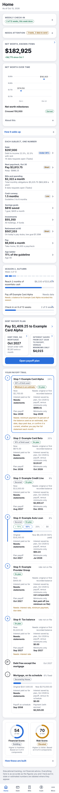

# DEMO_DATA: the invented household that fills every page

demo_data/ holds a complete dataset, one JSON file per dataset (37 files), that makes every page render with real looking content, plus offpage/ with the three datasets the page does not load (notes_log, bank_flows, bank_statements). Everything is invented: names start with "Example" (Example Home Loan, Example Card Alpha, Example Auto Loan, Example Provider Group), pay is a round salary, balances are round numbers. No figure or name comes from a person's accounts. The date the screenshots assume is 2026-10-17.

## What it is for

- To see the finished dashboard before entering anything (screenshots in demo_data/shots/).
- To try a first build end to end: upload the files as the datasets of a scratch dashboard.
- As the data behind the browser tests and the documents' tile inventory (the code base keeps the same files in src/data_all).
- As worked examples for INTAKE_GUIDE.md: open paystubs.json, card_statements.json, offpage/bank_flows.json.

Do not mix demo data with your own. For your own dashboard start from templates/.

## The household in words

A salaried earner paid twice a month into Savings (money moves to Checking before each payment), a mortgage with escrow, a home equity line, an auto loan, two credit cards, a medical balance, a tax balance, a support withholding, a workplace 401(k) with a second plan the money is moving to, an HSA, savings and checking, a few bills, and tasks, milestones and score history. Some datasets are deliberately thin so that Needs lines, the Planned chip and the "Needs: original or first recorded balance" trail text show on the screenshots; that is the missing-data protocol working.

## Screenshots

Taken with tools/make_shots.js at 390 px wide, light theme, folds closed, today 2026-10-17. Each file is the whole page, top to bottom (very long pages are cut at 5200 px).

| Page | File | What to look for |
|---|---|---|
| Home | demo_data/shots/home.png | check-in strip, Needs attention, net worth and its change, one number per subject, season, payoff header and trail, the two score rings |
| Home, dark | demo_data/shots/dark_home.png | the same page in the dark theme |
| Debt | demo_data/shots/debt.png | debt to income two ways, payoff plan, loan to value, timeline |
| Bills | demo_data/shots/bills.png | take-home share, obligations monthly and annual, due strip, statements |
| Cash | demo_data/shots/cash.png | the Cash card (spendable cash, In transit chip), balance cards (name and number), runway gauge, drift gap per account |
| Investments | demo_data/shots/investments.png | the two sections, holdings, growth and returns |
| Retirement | demo_data/shots/retirement.png | balance at target age, the 401(k) percent card and its Limit reached chip, plan year tile |
| Progress | demo_data/shots/progress.png | scores, age ladder, coverage rings, milestones, quests, badges |
| Tasks | demo_data/shots/tasks.png | the only page that lists task rows |
| Pay | demo_data/shots/pay.png | stub by stub, split of each check, year to date |
| Data and backup | demo_data/shots/data.png | last backup, backup buttons, as-of dates, what is still needed |



## Regenerating

```
node tools/make_shots.js demo_data/shots
```

needs Chromium (ENVIRONMENT.md). The data folder defaults to src/data_all; pass `--data dir` to render another.
